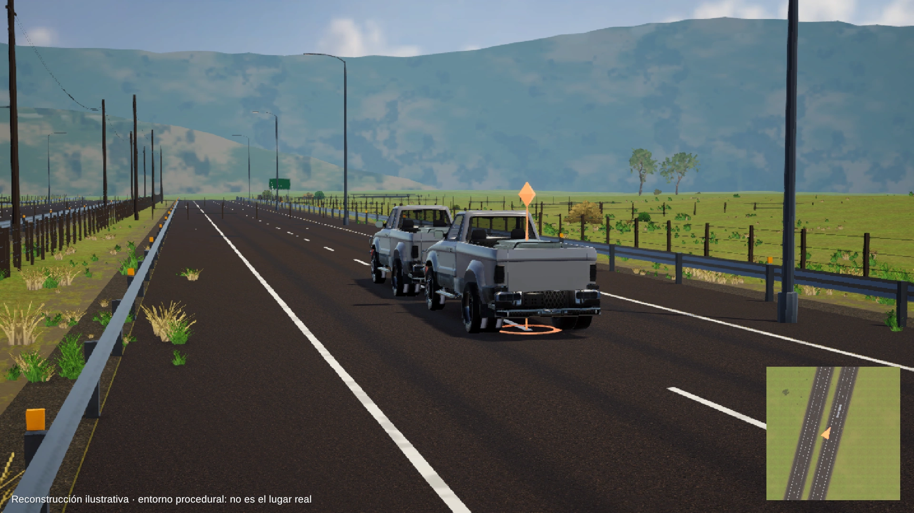
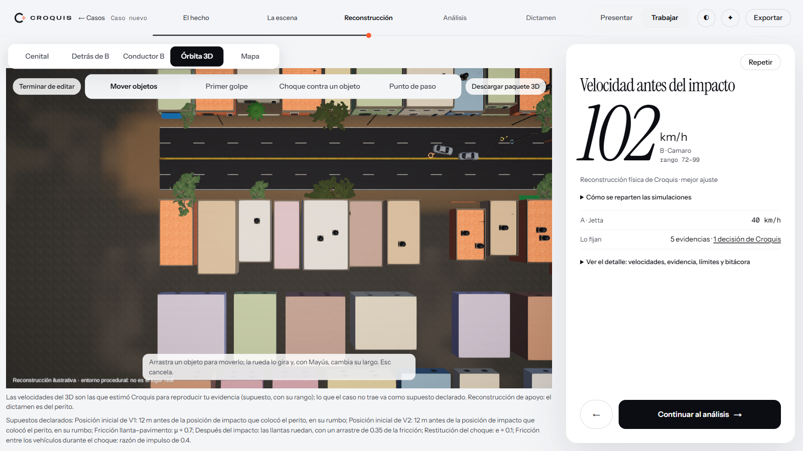

# Croquis

> Reconstrucción de hechos de tránsito con física, a partir de lo que narra el perito, para los peritos de **CESVI México**.
> **Reconstrucción ilustrativa. No asigna culpa ni estima lesiones; el dictamen lo firma el perito.**

El perito narra el hecho como lo escribe en sus reportes. Croquis lo ordena en una escena donde cada dato lleva su cita o queda marcado como supuesto, la reconstruye con un solver propio, la muestra en 3D y arma un dictamen con la estructura de los reportes de CESVI. **La IA ordena lo narrado, la física decide los números y el 3D solo reproduce.**

- **En vivo:** <https://croquis-sage.vercel.app/cesvi>
- **Estado en dos páginas:** [`docs/ESTADO.md`](docs/ESTADO.md)
- **Plan vigente:** [`docs/cesvi/PLAN-CESVI.md`](docs/cesvi/PLAN-CESVI.md) (v4)

Toda cifra de este archivo sale de un script de `eval/` cuya salida está versionada en `eval/results/`. Cada decisión técnica tiene su ADR en `docs/adr/`.



## El problema

Un perito de CESVI recibe un siniestro, revisa daños, posiciones y huellas, calcula velocidades y escribe un reporte. Lo hace a mano, con hojas de cálculo y un croquis. CESVI entregó **671 reportes** para este proyecto ([`eval/results/cesvi_corpus_extraccion.json`](eval/results/cesvi_corpus_extraccion.json)); de ahí salen el vocabulario, la estructura del dictamen y los casos con los que se mide Croquis.

CESVI pidió cuatro cosas para esta versión (plan v4): el 3D en Unity, los puntos intermedios y el punto inicial del choque, objetos que se pueden mover y un terreno que afecta la reconstrucción.

## Qué hace

1. **Narrar.** El perito escribe o pega su narración. Antes de salir del navegador se quitan nombres, teléfonos, placas, VIN, folios, pólizas y números de siniestro. Claude ordena el texto en datos con su cita literal; un verificador descarta toda cita que no esté en el texto.
2. **Colocar.** En el mapa, una pregunta a la vez: dónde fue, posiciones de impacto y finales, el primer golpe, puntos de paso, objetos y terreno (superficies, topes, relieve real).
3. **Reconstruir.** El solver busca las velocidades que reproducen la evidencia y da su rango. Dice qué evidencia fija cada número y qué queda como supuesto. Si dos hipótesis no caben juntas, muestra las dos y el perito elige.
4. **Ver.** El visor Unity reproduce el resultado: trayectorias, daño según el perfil de aplastamiento, personas, día y noche, lluvia, y edición en 3D que vuelve a correr el solver.
5. **Comparar.** Contra el reporte de CESVI, con el valor y el porcentaje de cada diferencia; y, si se quiere, contra la versión que declara un conductor.
6. **Dictaminar.** El dictamen sale en PDF y Word con la estructura de los reportes de CESVI, con las fotos del 3D, los supuestos y la leyenda ilustrativa.



## Qué no hace

- No asigna culpa ni dice quién miente.
- No estima lesiones ni muestra contenido gráfico de personas lesionadas.
- No inventa números: lo que el reporte o el perito no dan entra como supuesto declarado, con su justificación y su rango.
- No sustituye al perito: él elige entre hipótesis, corrige la escena y firma.
- Unity no calcula: todo movimiento sale del resultado del solver.

## Cómo probarlo

### En vivo

<https://croquis-sage.vercel.app/cesvi>. Abre el caso de AXA (A2010930) o empieza un «Caso nuevo». La [reproducción de reportes](https://croquis-sage.vercel.app/cesvi/reproduccion) muestra los 205 casos de la prueba congelada.

### En local (Windows, PowerShell)

Requisitos: Node 24.12, pnpm 12, Python 3.14 y uv (versiones en [`docs/adr/0001-stack.md`](docs/adr/0001-stack.md)).

```powershell
pnpm install
uv sync --all-packages --all-groups
pnpm dev                      # http://localhost:3000/cesvi
```

- **Sin llave de Claude,** el caso de AXA y la reproducción de reportes funcionan completos; leer una narración nueva con Claude necesita la llave.
- **Con llave:** copia `.env.example` a `.env.local` y pon tu `ANTHROPIC_API_KEY`. Hay un tope de gasto diario y un límite de peticiones por hora.
- **El 3D** baja el build de Unity y los modelos de Vercel Blob; sin red se usa el visor three.js de respaldo.

Pruebas:

```powershell
pnpm test                                   # TypeScript (Vitest)
uv run pytest -n auto                       # Python (referencia del solver)
pnpm --filter @croquis/web test:e2e         # Playwright, una e2e por flujo principal
dotnet test apps/visor-unity/tests/Croquis.Core.Tests -c Release   # núcleo del visor
```

El visor de escritorio y los builds de Unity no se compilan en CI; se publican con `tools/unity/` (ver [`docs/progress/U.md`](docs/progress/U.md)).

## Resultados medidos

### Contra los reportes de CESVI (E-R4 v4)

A Croquis se le da solo la narración de cada reporte, sin sus conclusiones, y lo que obtiene se compara con lo que concluyó CESVI. La prueba son 205 reportes apartados antes de ajustar nada. Medición: [`eval/results/cesvi_r4_v4_reproduccion_prueba.json`](eval/results/cesvi_r4_v4_reproduccion_prueba.json); las cuatro versiones lado a lado, en [`cesvi_r4_v4_comparacion.json`](eval/results/cesvi_r4_v4_comparacion.json).

| Qué se compara                                          | Croquis             | Línea base                          |
| ------------------------------------------------------- | ------------------- | ----------------------------------- |
| Modalidad, contra el título del reporte                 | 91 de 156 (58.3 %)  | 37.2 % (siempre «alcance»)          |
| Modalidad, contra la etiqueta de la lectura del reporte | 80 de 190 (42.1 %)  | 35.3 % (siempre «otra»)             |
| Modalidades con choque entre vehículos u objetos        | 74 de 123 (60.2 %)  | 37.4 % (siempre «alcance»)          |
| Zonas de contacto que da el reporte y Croquis encuentra | 222 de 312 (71.2 %) | —                                   |
| Zonas que da Croquis y están en el reporte              | 222 de 362 (61.3 %) | —                                   |
| Primer impacto de la secuencia                          | 92 de 135 (68.1 %)  | —                                   |
| Secuencia completa                                      | 69 de 135 (51.1 %)  | —                                   |
| Reportes que se reconstruyen y se ven en 3D             | 205 de 205          | —                                   |
| Velocidades por deformación                             | 0 de 5              | Las narraciones no traen el ancho L |

La modalidad contra el título sale de [`cesvi_r4c_titulo_prueba.json`](eval/results/cesvi_r4c_titulo_prueba.json). La v4 da lo mismo que la v3 en todos estos ejes: entre una y otra cambió el solver, no la lectura ni las reglas.

**Reversa** ([`cesvi_r4_reversa.json`](eval/results/cesvi_r4_reversa.json)). La narración sin conclusiones no dice quién retrocedía, así que la modalidad «reversa» queda en 0 de 9. Dado quién retrocede según el propio reporte, el golpe queda en la parte posterior del vehículo en 9 de 12 reportes de la prueba (21 de 26 en desarrollo) de los que tienen daño posterior.

**Carambolas** ([`cesvi_r4b_carambolas_prueba.json`](eval/results/cesvi_r4b_carambolas_prueba.json)). De 33 reportes de la prueba con tres o más vehículos, los 33 se reconstruyen y se ven en 3D; ocurren 21 de 31 impactos posteriores (con la primera versión, 2 de 32).

### AXA A2010930, con sus dos lecturas

| Lectura                                            | CESVI      | Croquis                  | Diferencia          |
| -------------------------------------------------- | ---------- | ------------------------ | ------------------- |
| Método de CESVI, por la separación de los restos   | 60.27 km/h | 60.27 km/h               | 0                   |
| Método de CESVI, por deformación                   | 63.15 km/h | 63.90 km/h               | +0.75 km/h          |
| Reconstrucción física, «cuadra con el daño medido» | 63.15 km/h | 56.87 km/h (54.79–78.39) | −6.28 km/h, −9.94 % |
| Alternativa, «cuadra con el reposo supuesto»       | 63.15 km/h | 34.44 km/h (30.07–44.44) | supuesto            |

- La reproducción del método está en [`axa_diagnostico.json`](eval/results/axa_diagnostico.json); la reconstrucción física, en [`axa_rango_estable.json`](eval/results/axa_rango_estable.json) y [`w8/axa_hipotesis.json`](eval/results/w8/axa_hipotesis.json).
- Con 20 semillas, el mejor ajuste y su rango no se mueven (0 km/h de diferencia entre semillas).
- Las dos hipótesis se muestran porque el reposo que el reporte no da (supuesto) y la deformación medida no caben juntos. El perito elige; mientras no elija, se ve la del daño medido.
- Nada se ajusta para coincidir con el reporte.

### Solver y visor

| Qué                                                             | Resultado                                              | Dónde                                                                             |
| --------------------------------------------------------------- | ------------------------------------------------------ | --------------------------------------------------------------------------------- |
| Paridad del solver TS con la referencia Python                  | 89 710 números, diferencia máxima 0                    | [`e7_parity.json`](eval/results/e7_parity.json)                                   |
| Resultado completo de AXA en el navegador (laptop de 8 GB)      | medianas de 9.25 a 9.56 s, meta ≤ 10 s                 | [`w8/tiempo_navegador_rondas.json`](eval/results/w8/tiempo_navegador_rondas.json) |
| Visor Unity en la web, nivel medio, laptop con Intel UHD, 1080p | 64.7 y 62.1 fps en la escena de referencia (día/noche) | [`e6_unity_media.json`](eval/results/e6_unity_media.json)                         |
| Lo mismo en carambola (la escena más pesada)                    | 59.6 y 56.3 fps: no llega a 60                         | [`e6_unity_media.json`](eval/results/e6_unity_media.json)                         |
| Visor de escritorio, nivel alto, RTX 4070 Laptop, 1080p         | de 312 a 415 fps en AXA, carambola y lateral           | [`e6_unity_escritorio.json`](eval/results/e6_unity_escritorio.json)               |

La reversa se reconstruye a la velocidad de una maniobra de reversa (5.68 km/h, de 3.06 a 9.07; NHTSA, DOT HS 811 024) cuando el perito no la da: [`t3_3_reversa.json`](eval/results/t3_3_reversa.json).

Las evaluaciones anteriores al trabajo con CESVI (E1 a E9: extracción de relatos, rigidez por clase, proyección de peatones, daño contra autos reales) siguen en `eval/results/` y se describen en [`docs/historial/README-v1.md`](docs/historial/README-v1.md).

## Mapa del repo

Dos frentes con carpetas propias (plan v4, §3):

- **U · visor Unity, contratos e integración**
  - `apps/visor-unity`: el visor. `Croquis.Core` no depende de Unity y se prueba con `dotnet test`.
  - `tools/unity`: builds, publicación en Blob, mediciones y el modo foto.
  - `packages/scene-schema`: los contratos (`escena`, `resultado` y `caso3d`) en JSON Schema. Zod, Pydantic y C# se generan; no se editan a mano.
- **W · web y física**
  - `apps/web`: Next.js. `/cesvi` es el producto; `/api/cesvi` y `/api/relieve`, sus rutas.
  - `packages/cesvi`: del expediente a la escena, reconstrucción, hipótesis, comparación con el reporte y dictamen.
  - `packages/solver-ts`: el solver de producción. `solver/`: la referencia en Python.
  - `packages/extraction` y `packages/croquis-2d`: lectura de la narración y croquis 2D.
  - `eval`: scripts de evaluación y `eval/results/`. `data`: datos con su registro de fuentes.
- **Documentación**
  - [`docs/ESTADO.md`](docs/ESTADO.md): qué existe, qué falta y qué está bloqueado.
  - `docs/progress/U.md` y `docs/progress/W.md`: bitácoras por frente. `docs/PROGRESS.md`: índice.
  - `docs/adr/`: decisiones. `docs/physics.md`: la física, con sus fuentes.
  - `docs/historial/`: planes anteriores y el README de antes de CESVI.

`packages/viewer` (el visor three.js) queda congelado como respaldo.

## Datos y recursos

Registro completo: [`data/SOURCES.md`](data/SOURCES.md) (datos) y [`assets/ASSETS.md`](assets/ASSETS.md) (recursos), con origen, URL, fecha, licencia y script.

| Qué                                            | Fuente                                    | Licencia o condición                                                      |
| ---------------------------------------------- | ----------------------------------------- | ------------------------------------------------------------------------- |
| 671 reportes de hechos de tránsito             | CESVI México                              | De uso libre para este proyecto; los lotes crudos no van a git por tamaño |
| Rigidez por clase, inercias, pruebas de choque | NHTSA (Vehicle Crash Test Database, CISS) | Dominio público de EE. UU.                                                |
| Velocidad en reversa                           | NHTSA, DOT HS 811 024                     | Dominio público de EE. UU.                                                |
| Fricción, percepción-reacción, proyección      | Literatura citada en `docs/physics.md`    | Se cita; no se redistribuye                                               |
| Calles y mapas                                 | OpenStreetMap                             | ODbL, con atribución en cada vista                                        |
| Relieve                                        | INEGI, Copernicus GLO-30 y SRTM           | Abiertos; condiciones de cada uno en `data/SOURCES.md`                    |
| Cuerpos de las personas                        | MakeHuman                                 | CC0                                                                       |
| Texturas, árboles y cielos                     | Poly Haven                                | CC0                                                                       |
| Tipografías                                    | Geist y Roboto                            | SIL OFL 1.1                                                               |

Los modelos de vehículos son genéricos por clase, sin logotipos ni marcas.

## IA responsable

Detalle en [`docs/responsible-ai.md`](docs/responsible-ai.md).

- **La IA solo ordena:** produce la escena. No genera geometría, trayectorias ni números físicos.
- **Cada dato lleva su fuente:** la cita literal, o la marca de supuesto con su justificación.
- **Datos personales:** se quitan en el navegador antes de enviar el texto a Claude.
- **Sin culpas ni diagnósticos:** los avisos dicen qué no cabe con la evidencia y qué conviene revisar, nunca quién tuvo la culpa.
- **Leyenda ilustrativa** en cada vista y en cada exportación.
- **Toda diferencia con un reporte de CESVI** se muestra con su valor y su porcentaje.

## Límites

- **La narración manda.** Si no dice quién retrocedía o no trae el ancho dañado, Croquis no lo adivina: por eso la reversa y las velocidades por deformación quedan en cero en la E-R4.
- **Rigidez de otra flota.** La rigidez por clase viene de pruebas de vehículos de Estados Unidos.
- **Volcadura.** El solver decide si un vehículo se vuelca, pero no integra el giro en el tiempo; el 3D lo ilustra.
- **Reversa.** El vehículo llega a velocidad constante: no se modela el arranque desde detenido.
- **Rendimiento.** En la laptop de 8 GB, la carambola en nivel medio queda en 56 a 60 fps, y el resultado completo de AXA tarda poco menos de 10 s.
- **Acceso.** `/cesvi` es público y no hay cuentas; cuando los peritos usen sus propios casos hará falta autenticación.

La lista completa de lo pospuesto está en `docs/PROGRESS.md`, «Endurecimiento pendiente».

## Siguiente paso

1. La demo con CESVI y sus comentarios.
2. W9: las relecturas grabadas y el prompt del corpus (gasta API; lo autoriza René).
3. La segunda ronda con personas y sus tres problemas más frecuentes.

## Licencia y atribución

- **Código:** MIT (`LICENSE`).
- **Reportes de CESVI:** de uso libre para este proyecto, por entrega de CESVI México.
- **OpenStreetMap:** © colaboradores de OpenStreetMap, ODbL.
- **NHTSA:** datos públicos del gobierno de EE. UU.; se cita a NHTSA.
- **Recursos:** ver [`assets/ASSETS.md`](assets/ASSETS.md).
