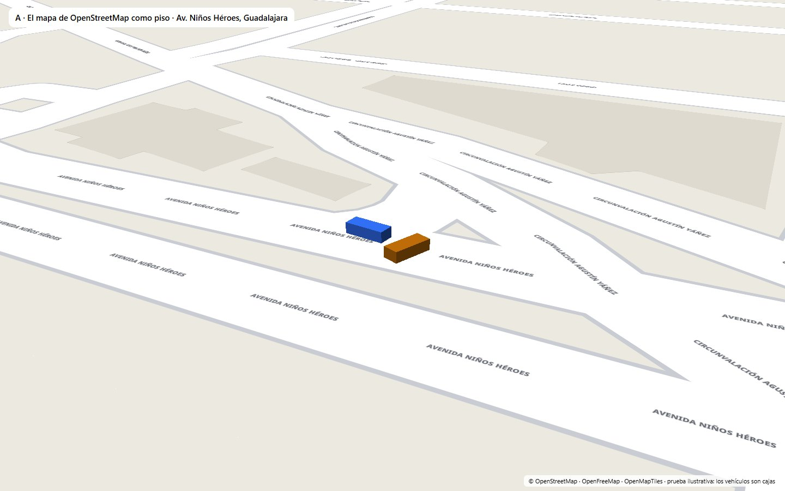
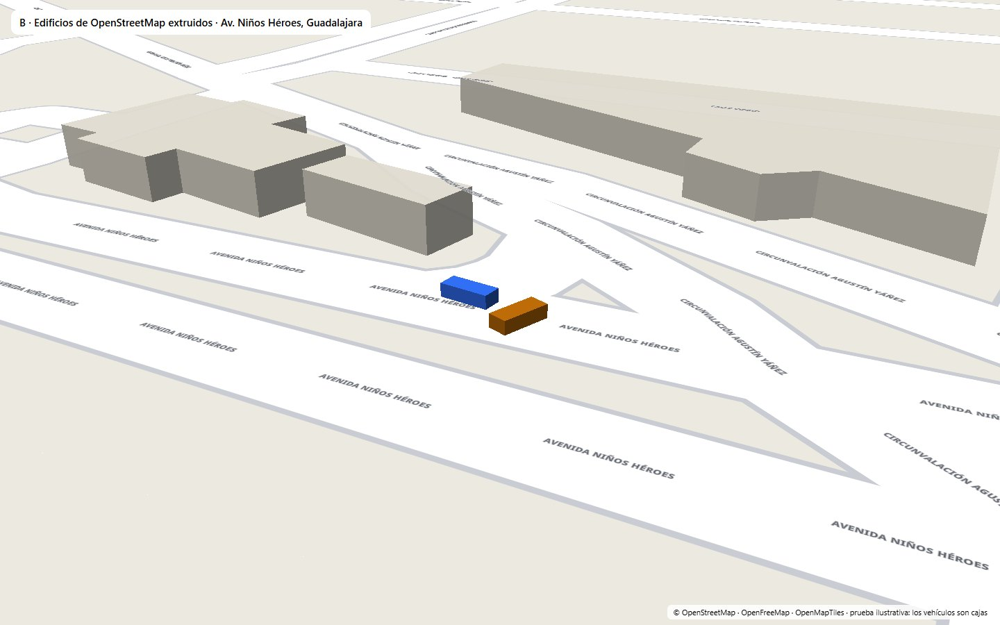

# Ronda 4, punto 9 · Mapa real en Unity: opciones para decidir

René pidió (2026-11-18) investigar, sin construir, un modo aparte de «mapa real»: el perito marca el lugar, el alrededor viene del mapa real y solo el choque es 3D. El entorno procedural de hoy se queda. Este documento compara las opciones y recomienda; el detalle, con las citas textuales de cada licencia y sus fuentes, está en el anexo `mapa-real-unity-investigacion.md`.

**Precios y licencias:** consultados el 2026-11-18 en las páginas oficiales; cambian, así que hay que volver a mirarlos antes de contratar.

## 1 · De dónde partimos

- **Lo que ya es real:** el trazo de las calles, que viene de OpenStreetMap. Edificios, banquetas y árboles son inventados (procedurales).
- **El visor:** Unity 6000.3 con URP, compilado para la web con los hilos apagados y 2 GB de memoria como máximo.
- **Lo que pide cualquier opción:**
  - un cambio pequeño al contrato (`caso-3d` y el puente);
  - un build nuevo de Unity, que compila el colaborador.
- **Tres cosas del producto que la licencia puede romper:**
  - las tres fotos del dictamen, que salen de Unity;
  - el video descargable;
  - la demo local sin internet.

## 2 · Las opciones

Costo al mes para 100, 1 000 y 10 000 escenas cargadas, con unas 100 teselas por escena (600 × 600 m a zoom 19).

| Opción                                                       | Costo (USD)                              | ¿Sin red y en caché?                     | ¿En el PDF del dictamen?          | ¿En el video?          | En Unity para la web                                                             | Esfuerzo estimado       |
| ------------------------------------------------------------ | ---------------------------------------- | ---------------------------------------- | --------------------------------- | ---------------------- | -------------------------------------------------------------------------------- | ----------------------- |
| **A1** · Mapa de OpenStreetMap como piso (OpenFreeMap)       | 0 / 0 / 0                                | Sí                                       | Sí, con atribución                | Sí, con atribución     | Una textura; no cambia el build                                                  | 3–5 días                |
| **A2** · Foto satelital de Esri (World Imagery) como piso    | 0 / 0 / 0 (2 millones de teselas gratis) | No (solo la caché de 24 h del navegador) | **Sí, explícito**, con atribución | No lo dice             | Una textura                                                                      | A1 + 2–4 días           |
| **A2** · Foto satelital de Google (Map Tiles 2D)             | 0 / 0 / 540                              | No                                       | Sin permiso                       | Solo promocional, 30 s | Una textura                                                                      | A1 + 2–3 días           |
| **A2** · Foto satelital de Mapbox                            | 0 / 0 / 62.50                            | 30 días, mismo equipo                    | No para satélite                  | Solo promocional       | Una textura                                                                      | A1 + 2–3 días           |
| **B1** · Google Photorealistic 3D Tiles con Cesium for Unity | 0 / 0 / 54                               | No                                       | No                                | Solo promocional, 30 s | **Experimental**: pide encender hilos y cambiar los encabezados de todo el sitio | 10–20 días, riesgo alto |
| **B2** · Edificios de OpenStreetMap extruidos por nosotros   | 0 / 0 / 0                                | Sí                                       | Sí, con atribución                | Sí, con atribución     | Geometría propia; no cambia el build                                             | 5–8 días                |

**Otras opciones revisadas:**

- **MapTiler:** 30 USD al mes desde el primer uso comercial; prohíbe capturas.
- **Cesium ion:** 149 USD al mes.
- **INEGI:** sus términos son libres, pero no encontré un servicio de ortofotos que se pueda consumir.

Los plazos son estimaciones gruesas: nadie abrió todavía el código del entorno en Unity para medirlos.

## 3 · Lo que más pesa de cada una

### A1 · El mapa como piso

- **A favor:** gratis; funciona sin internet, en el PDF y en el video; no cambia el build de Unity (es una textura).
- **En contra:** agrega poco sobre lo que ya hay. Las calles ya son las reales; se sumarían manzanas, parques y nombres de calles.
- **Prueba visual** (Av. Niños Héroes y Circunvalación Agustín Yáñez, Guadalajara; el cruce de un reporte de CESVI):

### A2 · La foto satelital como piso

- **A favor:** es lo que el perito reconoce como «el lugar»: camellones, marcas del pavimento, entradas, árboles. Con Esri sale gratis a nuestro volumen y su licencia permite, de forma explícita, la imagen fija en un PDF con atribución.
- **Medido en 12 puntos de México** (`eval/results/ronda4_mapa_real_datos.json`): resolución de 0.31 a 0.5 m por pixel, con imágenes del 2025-01-30 al 2026-05-15, también en tres carreteras rurales.
- **En contra:**
  - **No funciona sin internet.** En la demo local habría que caer al mapa (A1) o al entorno procedural.
  - **La foto puede quedar corrida.** Su exactitud declarada es de 5 a 8.47 m. El perito tendría que poder ajustarla, y el modo se declara ilustrativo.
  - **Trae los coches de ese día** pintados en el piso, bajo los vehículos 3D.
  - **El video:** la licencia de Esri nombra PDF, GIF, JPEG y HTML; del video no dice nada. Habría que preguntarles o dejar el video sin la foto.
  - **Google y Mapbox quedan descartados para esto:** no permiten la imagen en el dictamen.
- **Prueba visual:** falta. Necesita una cuenta de Esri (gratis) que solo René puede crear.

### B1 · Google Photorealistic 3D Tiles

- **A favor:** es lo más vistoso: la ciudad en 3D con textura real. En dinero es barato (1 000 escenas al mes gratis).
- **En contra:**
  - **Experimental en la web.** Cesium for Unity lo marca así desde diciembre de 2025. Pide encender los hilos del build y mandar encabezados de aislamiento en todo el sitio. Con ellos, cada recurso de otro origen (el build y los modelos en Blob, los mosaicos del mapa) tiene que venir con permiso, o deja de cargar.
  - **Memoria.** Hay reportes de usuarios con 6 a 7 GB de uso; el visor de hoy tiene un tope de 2 GB y los peritos usan laptops de 8 GB.
  - **Sin fotos en el dictamen, sin demo local y sin video.** Google prohíbe guardar, precargar y usar sin red, y solo permite video promocional de 30 s.
  - **No se puede mezclar con mapas que no sean de Google** en la misma aplicación; la web usa OpenStreetMap.
  - **A nivel de calle se ve derretido.** La fotogrametría es aérea, y las cámaras «conductor» y «acera» de Croquis están justo ahí.
  - **No sé qué ciudades mexicanas tienen 3D.** La cobertura oficial es un mapa interactivo, sin lista.
- **Prueba visual:** falta. Necesita una llave de Google con tarjeta, que solo René puede dar.

### B2 · Edificios de OpenStreetMap extruidos

- **A favor:** gratis; funciona sin internet, en el PDF y en el video; no necesita Cesium ni hilos.
- **En contra: en México casi no hay edificios en el mapa.** Figuras de edificios a 300 m de cada punto, en las teselas que ya baja la web (`eval/results/ronda4_mapa_real_datos.json`):

  | Punto                              | Figuras de edificios |
  | ---------------------------------- | -------------------- |
  | CDMX, Zócalo                       | 41                   |
  | Monterrey, centro                  | 13                   |
  | CDMX, Roma Norte                   | 12                   |
  | Guadalajara, centro                | 12                   |
  | Toluca, centro                     | 5                    |
  | Atlacomulco                        | 5                    |
  | Ecatepec (periferia)               | 2                    |
  | Metepec, residencial               | 1                    |
  | El cruce del reporte (Guadalajara) | 1                    |

  Las teselas juntan edificios vecinos en una figura, así que el número real de edificios es mayor; aun así, fuera de los centros las manzanas salen vacías. Las alturas casi nunca vienen en el mapa: habría que suponerlas y declararlo. Las fachadas serían lisas.

- **Prueba visual** (el mismo cruce; las demás manzanas no tienen ningún edificio en el mapa):

## 4 · Mi recomendación

**Hacer la opción A en dos capas, y no hacer la B por ahora.**

1. **A1, el mapa como piso:** la base del modo «mapa real». Sirve siempre, también sin internet, en el dictamen y en el video.
2. **A2 con Esri, la foto satelital encima,** cuando hay internet. Lleva su atribución, un ajuste manual para alinearla y el aviso de que es ilustrativa. Es lo que más acerca la escena al lugar real por menos esfuerzo y sin costo.
3. **B1 (Google 3D): no ahora.** Obliga a rehacer el build web y los encabezados del sitio por una función experimental, y deja al modo sin fotos del dictamen, sin demo local y sin video. Si más adelante interesa, lo sensato es probarlo solo en el visor de escritorio.
4. **B2 (edificios extruidos): no.** Con tan pocas huellas en México, la mayoría de los casos se vería igual que A1, y las alturas serían supuestas.

Total estimado de A1 + A2: de 5 a 9 días, más el build del colaborador.

## 5 · Lo que René decide

1. **Cuál se hace:** A1 sola, A1 + A2 (mi recomendación), o alguna B.
2. **¿El modo «mapa real» debe salir en las fotos del dictamen y en el video?** Si sí, Google queda fuera y con Esri el video queda en duda.
3. **¿Debe funcionar en la demo local sin internet?** Si sí, solo A1 (y B2) lo cumplen; la foto satelital se apagaría ahí.
4. **Para la prueba visual que falta:** una cuenta gratuita de Esri (ArcGIS Location Platform) con su llave en `.env.local`. Con ella saco la misma vista del cruce de Guadalajara con la foto satelital, dentro de la cuota gratis.
5. **Si quiere ver Google 3D antes de descartarlo:** una llave de Google Maps Platform con facturación activa y tope diario en la cuota gratis. Con ella se sabría qué ciudades de los casos de CESVI tienen 3D.

## 6 · Lo que no se pudo verificar

- Qué ciudades mexicanas tienen fotogrametría 3D de Google.
- La resolución y la fecha de la foto satelital de Google y de Mapbox en México (piden llave).
- Si Cesium for Unity funciona bien con URP 17.3 en la web, y cuánta memoria usa con las teselas de Google.
- Si Esri permite la foto en un video, y si una imagen fija suya puede guardarse como piso de un caso para la demo local.
- Si las cuentas gratuitas de Esri piden tarjeta.
- Cómo llena OpenFreeMap la altura de un edificio cuando OpenStreetMap no la trae.

## 7 · De paso

- El servidor principal de Overpass (de donde la web baja las calles) contesta 406 al User-Agent de Croquis. En producción las calles deben estar llegando por los servidores de respaldo. Queda como pendiente revisarlo.
