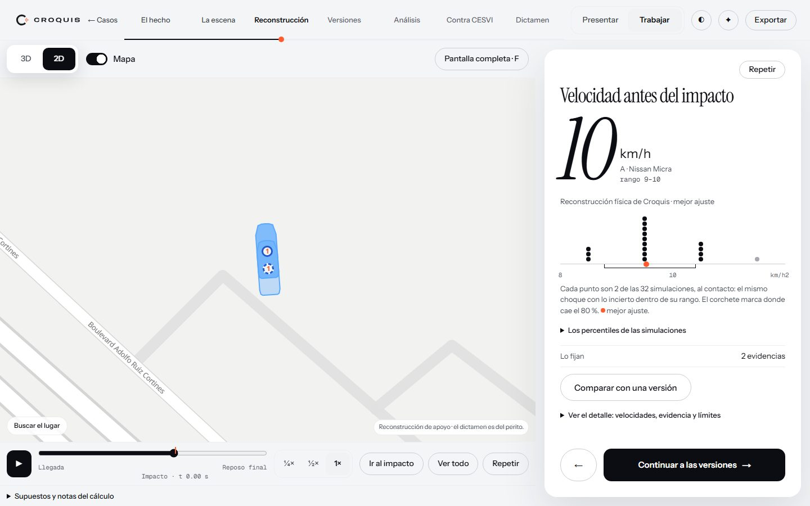
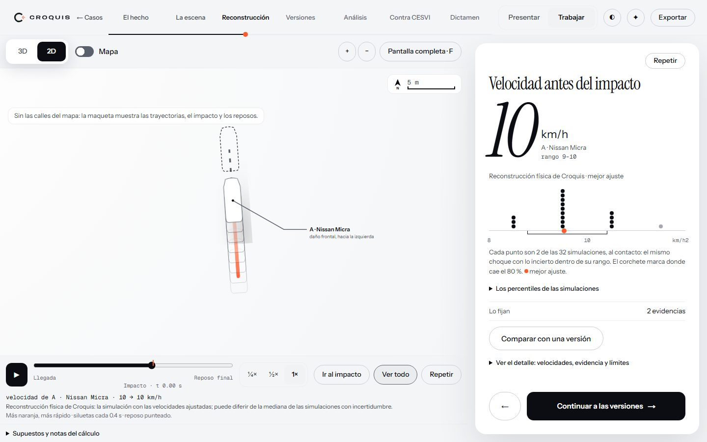
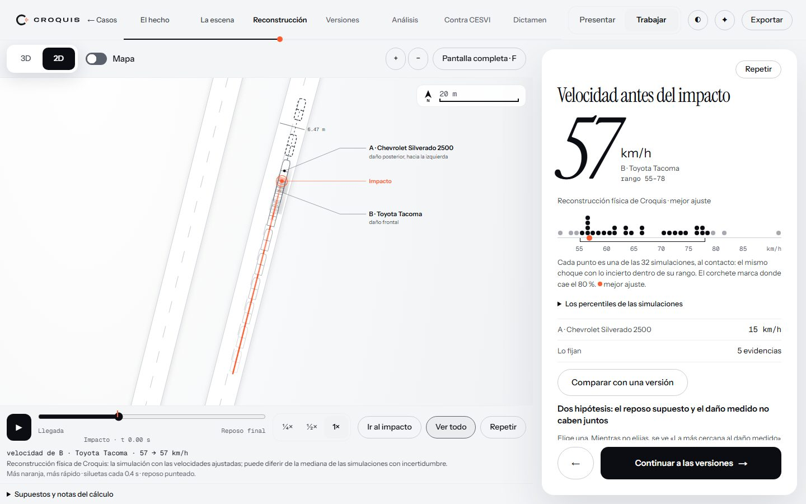
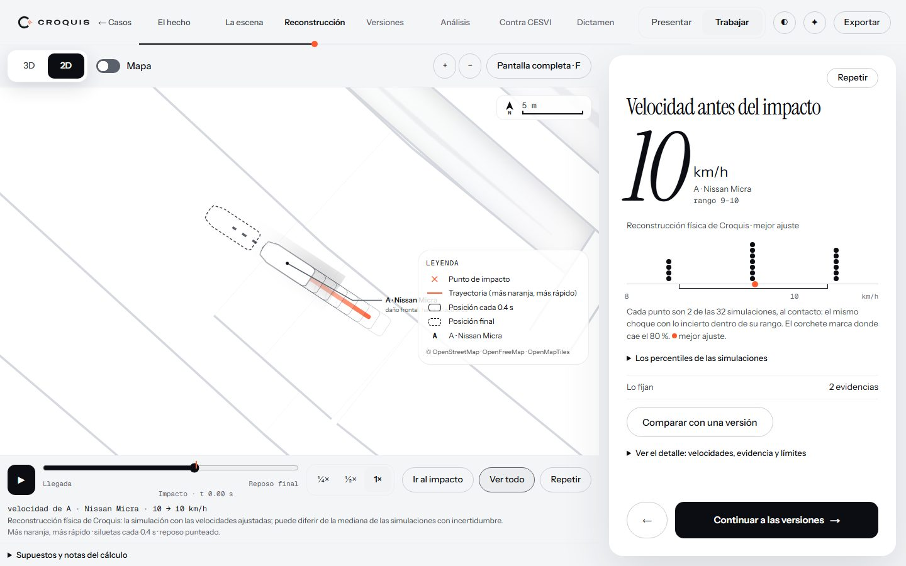
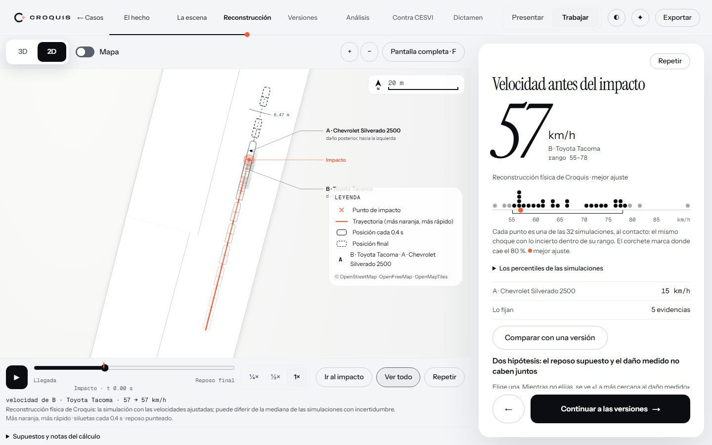
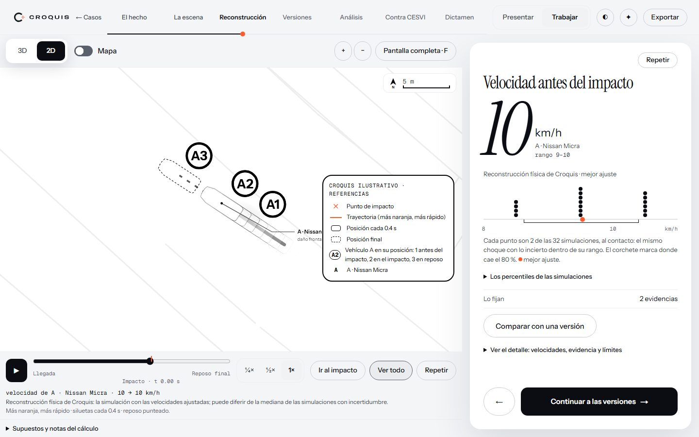
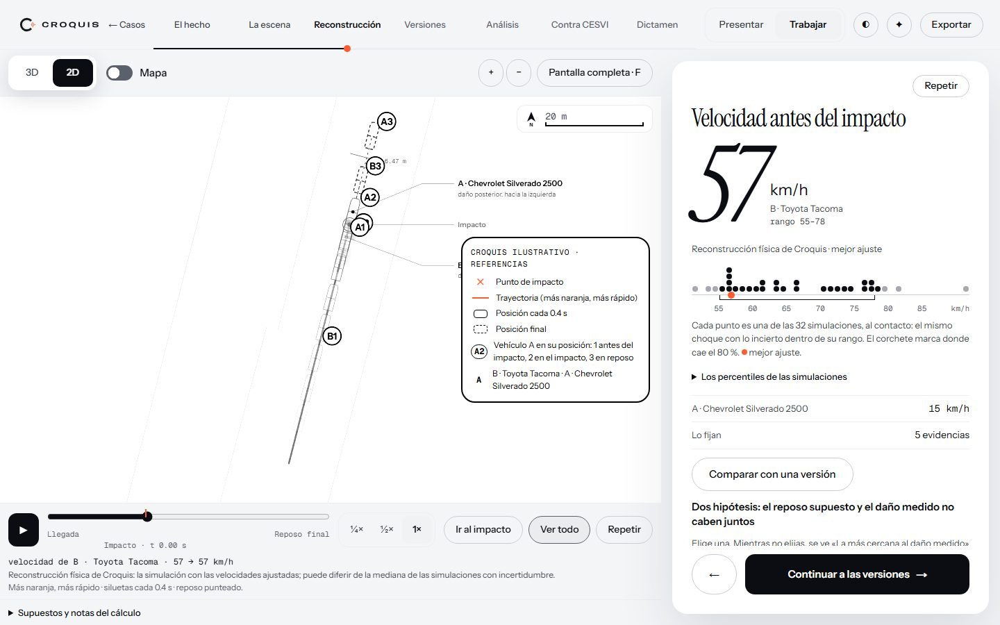
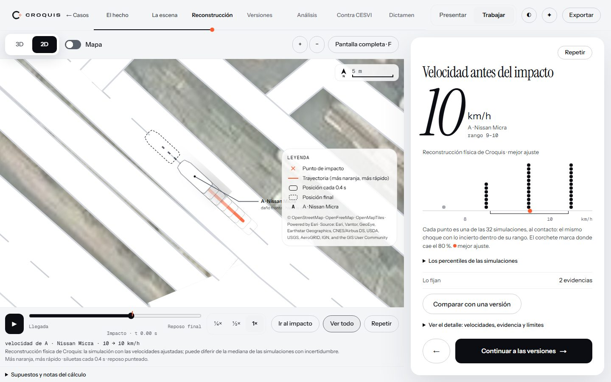
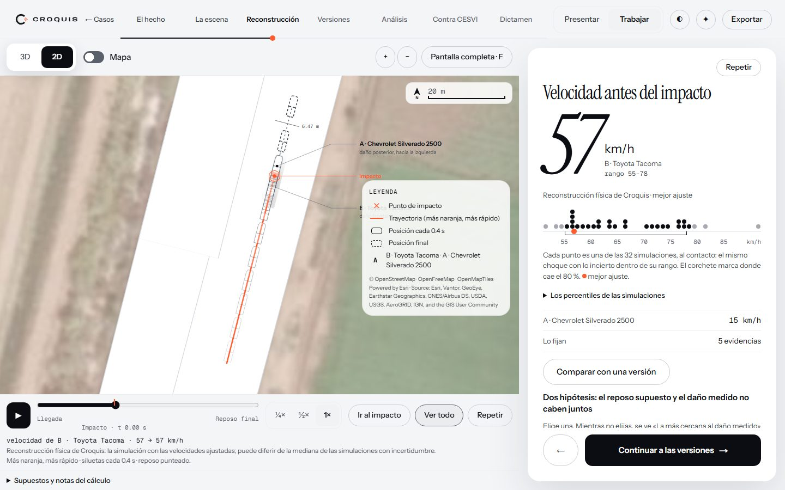

# Ronda 4 · El 2D de Reconstrucción como el croquis de un perito: tres propuestas

René, 2026-11-18, con el caso cesvi-cf708e9fed: «El 2D de Reconstrucción no se entiende». Señaló:

- X1 y X2 encimadas sin decir qué son;
- el vehículo como un rectángulo azul atravesado en la calle;
- círculos con «1» y un icono de inicio sin explicación;
- un mapa de fondo deslavado.

Pidió que se lea como el croquis de un perito: bordes de la vía y carriles; siluetas con su letra y su nombre; trayectorias; punto de impacto; posiciones finales; escala y norte; una leyenda corta. El mapa o la foto satelital, de fondo opcional y tenue.

**No se construye la versión final hasta que René elija.** Ningún número cambia: solo cambia cómo se dibuja.

Las capturas salen de un prototipo sobre la maqueta real, con `?croquis=1|2|3`. Sin el parámetro, nada cambia. El caso cf708 se armó con lo que propone Croquis: el choque al centro, la flecha propuesta y «quedó junto al choque».

## 1 · Cómo es hoy

- **Con «Mapa» encendido** (lo que vio René), el 2D es otra vista: el mapa de la calle con marcadores (un rectángulo azul, círculos «1»), sin leyenda.
- **Sin el mapa**, es la maqueta: siluetas, trayectorias y etiquetas.
  - En cf708 no tenía calles («Sin las calles del mapa…»): Overpass tardaba unos 35 s. Ya está arreglado con las calles de las teselas del mapa.

## 2 · Las tres propuestas

Las tres dejan una sola vista, la maqueta, y quitan la vista con marcadores: «Mapa» solo pone el lugar debajo, tenue.

### Propuesta 1 · El croquis de siempre, con el lugar tenue al fondo

La maqueta con el mapa de OpenStreetMap al 32 % debajo y una leyenda corta. Los símbolos son el punto de impacto, la trayectoria, la posición cada 0.4 s, la posición final y las letras de los vehículos.

- **A favor:** se reconoce el lugar sin perder el croquis. Es la que menos cambia.
- **En contra:** sigue siendo un dibujo «de pantalla», en color, no el de un dictamen impreso.

### Propuesta 2 · Croquis pericial, en papel

Papel blanco, en grises. Cada vehículo lleva su letra con el número de la posición en un círculo: A1 antes del impacto, A2 en el impacto, A3 en reposo. Así se rotula un croquis pericial. Un cuadro de referencias explica cada símbolo.

- **A favor:** se lee como los croquis de los reportes de CESVI y sirve igual en el dictamen impreso.
- **En contra:**
  - Pierde el color de la velocidad.
  - Los bordes de la vía salen demasiado claros en gris: en la versión final irían en negro.
  - Con varios vehículos juntos, los círculos se acercan.

### Propuesta 3 · El croquis sobre la foto satelital

La maqueta sobre la foto de Esri al 55 %, con su crédito, cuando hay internet. Sin internet, el mapa.

- **A favor:** es lo que más se parece al lugar real (camellones, acotamientos, entradas).
- **En contra:**
  - La foto puede quedar corrida de 5 a 8.5 m. En AXA se nota: la vía dibujada y la de la foto no coinciden. Haría falta el mismo ajuste que en el 3D.
  - Trae los coches de ese día.

## 3 · Mi recomendación

**La 2, con la 1 como fondo opcional.** Croquis pericial en papel por omisión, que es lo que se lee como un perito y lo que va al dictamen. «Mapa» pone el lugar tenue debajo, y «Foto» la foto satelital, con su ajuste.

En la versión final, además:

- bordes de la vía y carriles en negro;
- un solo «Impacto» rotulado aunque haya varios (X1, X2 con su número en la leyenda);
- el cuadro de referencias con la escala y el norte dentro.

## 4 · Lo que René decide

1. **Cuál propuesta:** 1, 2, 3 o una mezcla.
2. **Si el 2D del dictamen debe ser el mismo** que el de la pantalla.
