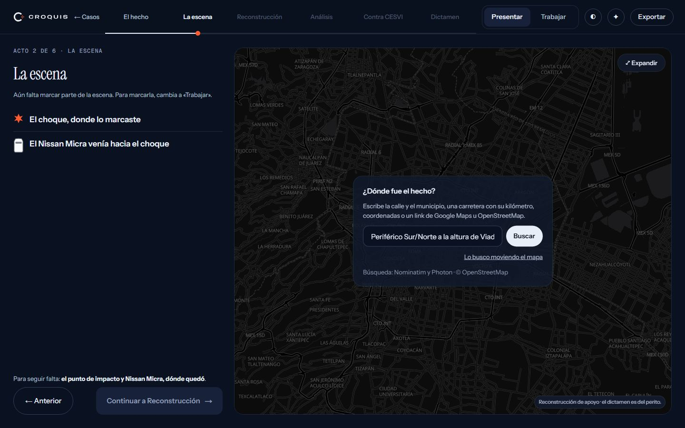
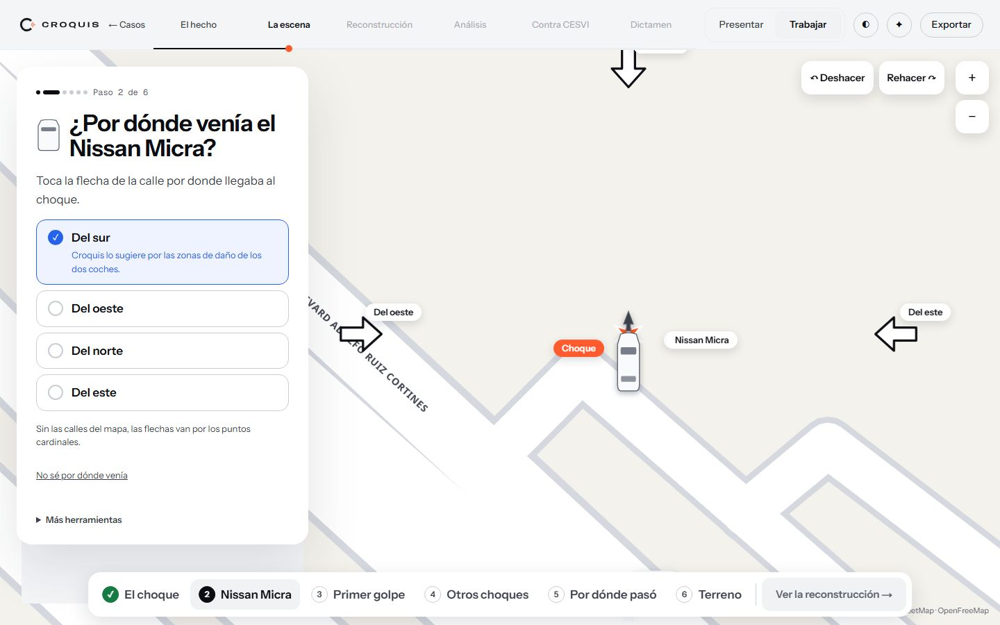
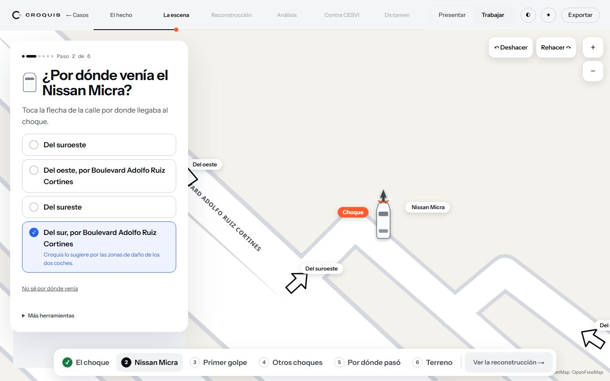
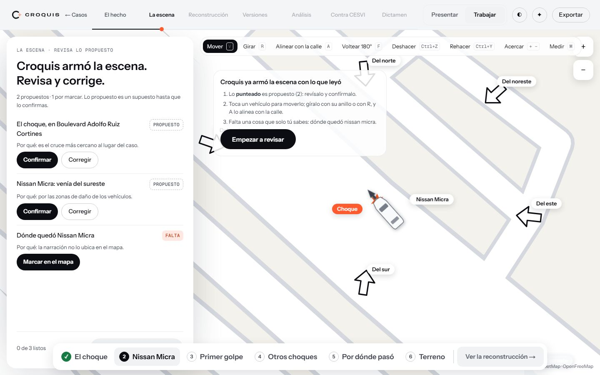
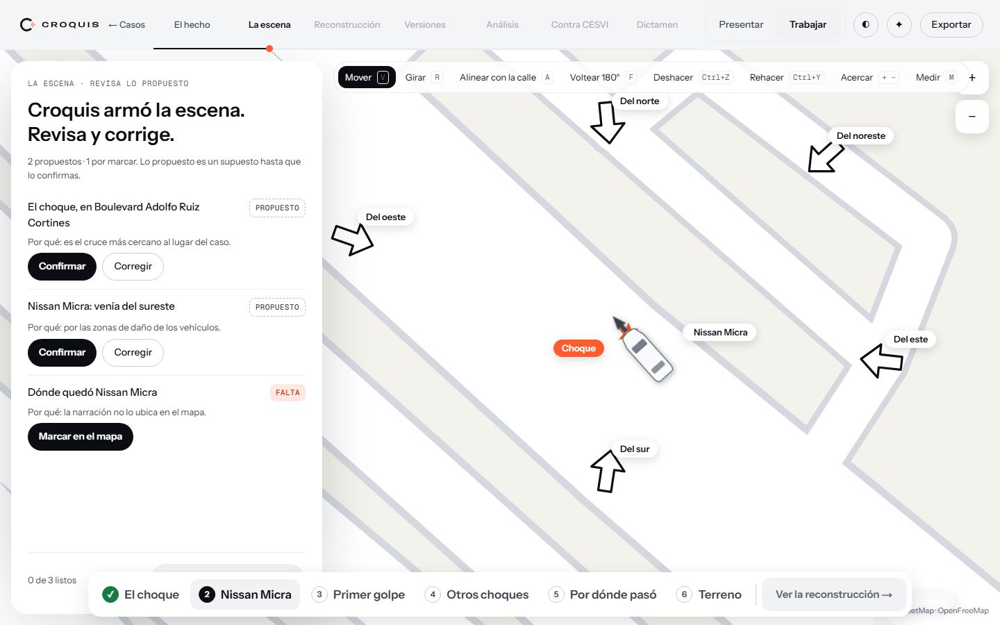
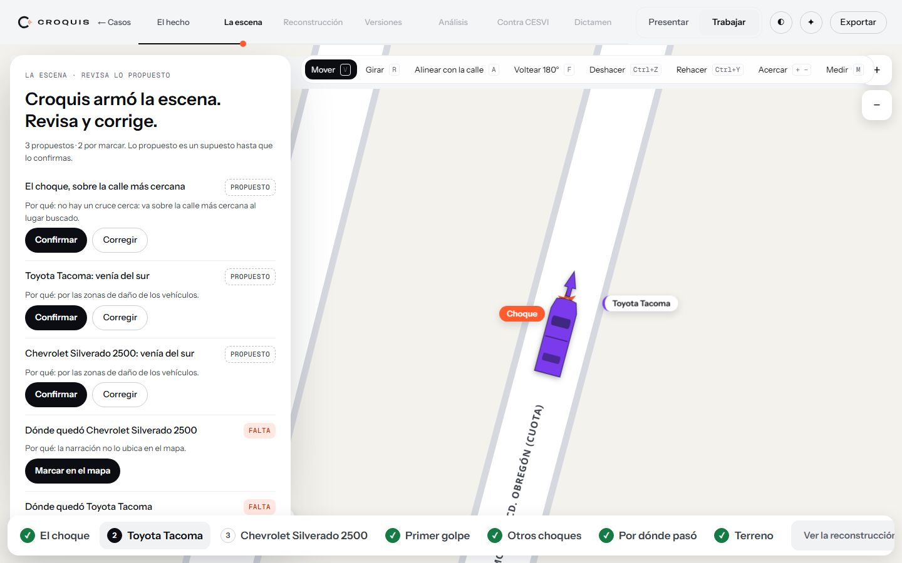
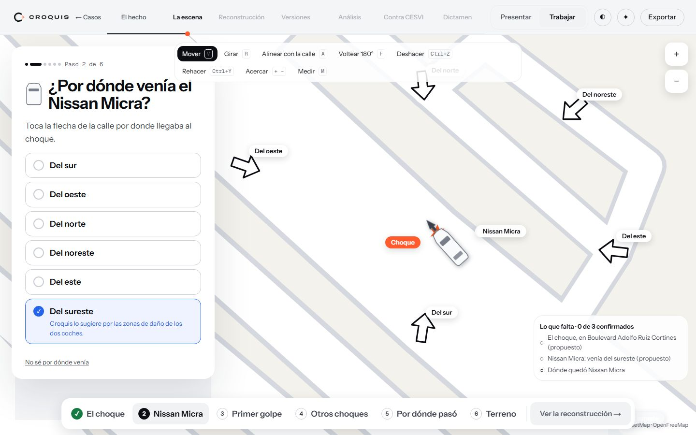
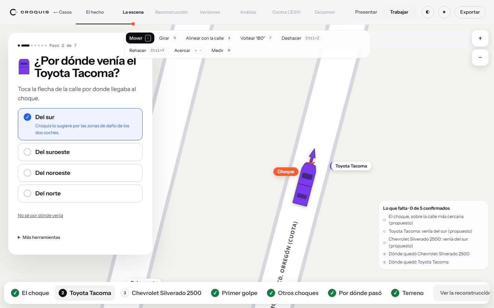
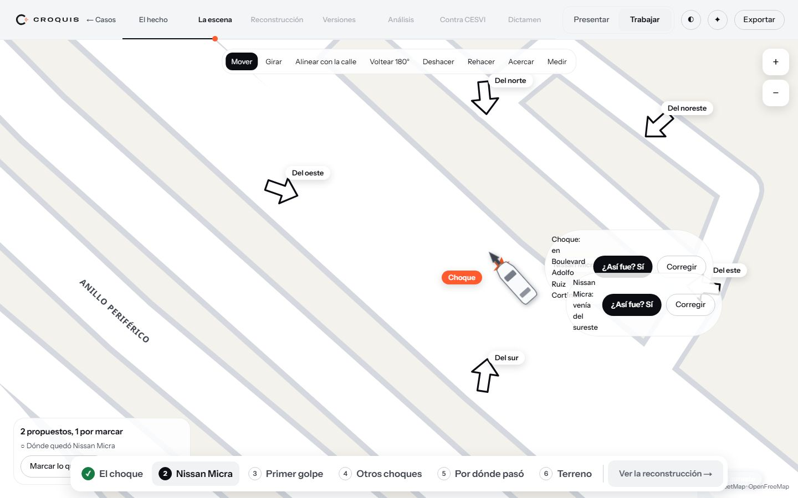
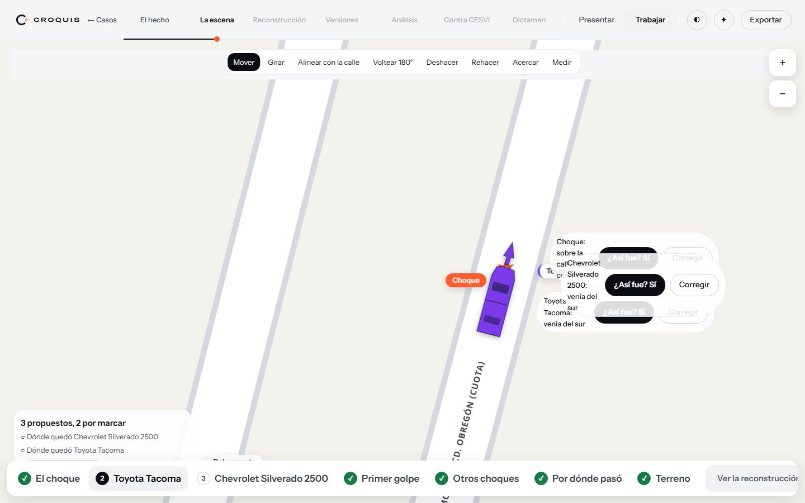

# Ronda 4 · La primera experiencia en La escena: tres propuestas para elegir

René lo probó el 2026-11-18. Al empezar a marcar, el perito se siente sin rumbo y sin las herramientas que necesita, y eso desmotiva a seguir. Es el momento que decide si llega a ver la reconstrucción.

Pidió cuatro cosas:

- Que Croquis proponga la escena ya armada y el perito la revise.
- Las herramientas a la vista, cada una con su tecla.
- Una guía corta al entrar y una lista de lo que falta.
- Dos o tres propuestas con capturas del caso cesvi-cf708e9fed y de AXA, para elegir una.

**No se construye la versión final hasta que René elija.**

Las capturas salen de un prototipo sobre La escena real. Se activa con `?propuesta=1|2|3` y, en AXA, `&desde=cero`, para armarla desde la narración y no desde el reporte. Sin el parámetro, nada cambia. Los números del mapa y la escena propuesta son reales; los botones nuevos todavía no hacen nada.

## 1 · Cómo es hoy

En cesvi-cf708e9fed (un reporte importado, el Periférico a la altura de Viaducto), en producción:

1. **Abre en «Presentar»:** para marcar hay que pasar a «Trabajar». Luego, buscar el lugar y elegirlo.
2. **Se marca el choque a mano.** El Nissan Micra queda **vertical, atravesado** al boulevard.
3. **Las flechas de «¿Por dónde venía…?» salen por los puntos cardinales**, con el aviso «Sin las calles del mapa…».
   - A los 40 s, cuando por fin responde Overpass, cambian a las del boulevard.
   - Antes de hoy, Overpass ni respondía: rechazaba a Croquis con 406. Arreglado en la ronda.
4. **Las herramientas están escondidas:** deshacer y rehacer arriba a la derecha, y lo demás en «Más herramientas».

## 2 · Lo que ya quedó, sirva la propuesta que sirva

- **Las calles salen de las teselas del mapa,** las mismas que ya dibujan el boulevard, en cuanto el mapa terminó de dibujar. Overpass, si llega, solo afina. Prueba: `apps/web/src/lib/calles-teselas.test.ts`, con las teselas grabadas del lugar del caso.
- **Croquis arma la escena** (`proponerEscena`, `apps/web/src/lib/escena-propuesta.ts`), sin preguntar:
  - el choque en el cruce que nombra la narración o en el más cercano; si no hay cruce, sobre la calle más cercana;
  - cada vehículo del primer choque en él, **alineado con la calle** y llegando por donde dice la narración o por donde lo indican los daños;
  - todo como supuesto, con su porqué;
  - lo que no puede proponer (dónde quedó cada vehículo, si la narración no lo ubica) va a una lista de lo que falta.
- **Ningún número de la reconstrucción cambia:** solo se coloca.

## 3 · Las tres propuestas

Las tres comparten la barra de herramientas (Mover V, Girar R, Alinear con la calle A, Voltear 180° F, Deshacer Ctrl+Z, Rehacer Ctrl+Y, Acercar + −, Medir M) y la guía de entrada en tres líneas: qué está propuesto, cómo se corrige y qué falta.

### Propuesta 1 · «Revisa lo que armó Croquis»

La escena completa en el mapa. A la izquierda, la lista: cada cosa propuesta con su porqué y «Confirmar» o «Corregir», y lo que falta, con «Marcar en el mapa». Abajo, «0 de 3 listos» y «Ver la reconstrucción», que se activa al completar.

- **A favor:**
  - Se ve todo de un vistazo: qué hizo Croquis, por qué y qué falta.
  - El perito revisa en lugar de construir.
  - La lista es la misma que va al dictamen como «supuestos».
- **En contra:**
  - Si la lista es larga (una carambola de cuatro), hay que desplazarla.
  - El perito podría confirmar todo sin mirar el mapa.

### Propuesta 2 · Una pregunta a la vez, con la respuesta ya puesta

El recorrido de hoy, pero cada pregunta llega contestada por Croquis en el mapa. «Del sur» ya está marcado y el vehículo ya está en la calle. Abajo a la derecha, la lista de lo que falta.

- **A favor:**
  - Es lo que el perito ya conoce, más rápido: cada paso es un toque.
  - Imposible saltarse algo.
- **En contra:**
  - Sigue siendo un paso a la vez: no se ve la escena completa hasta el final.
  - Con seis pasos, se siente largo aunque cada uno sea un toque.

### Propuesta 3 · La escena primero, las dudas sobre el mapa

Sin panel. Cada cosa propuesta lleva, junto a ella en el mapa, «¿Así fue? Sí» y «Corregir». Una tarjeta chica dice cuánto falta.

- **A favor:**
  - El mapa grande; se confirma donde se mira.
  - Lo más parecido a corregir un croquis a mano.
- **En contra:**
  - Con dos vehículos juntos en el choque, las etiquetas compiten por el espacio.
  - El porqué de cada propuesta queda menos a la vista.

## 4 · Mi recomendación

**La propuesta 1.** Es la que mejor responde a lo que pidió René: la escena ya armada, que se revisa y corrige, con la lista de lo que falta a la vista y el porqué de cada cosa. De la 3 tomaría que, al tocar un vehículo en el mapa, se marque su fila en la lista y aparezcan junto a él «Confirmar» y el anillo de giro.

## 5 · Lo que René decide

1. **Cuál propuesta:** 1, 2, 3 o una mezcla.
2. **La medición con una persona que no haya usado Croquis:** cuánto tarda en dejar la escena lista, antes y después, y dónde se atora. Necesita a la persona y la sesión, que solo René puede dar; queda en «Bloqueado» de `docs/PROGRESS.md`. El protocolo de E9 ya existe.
