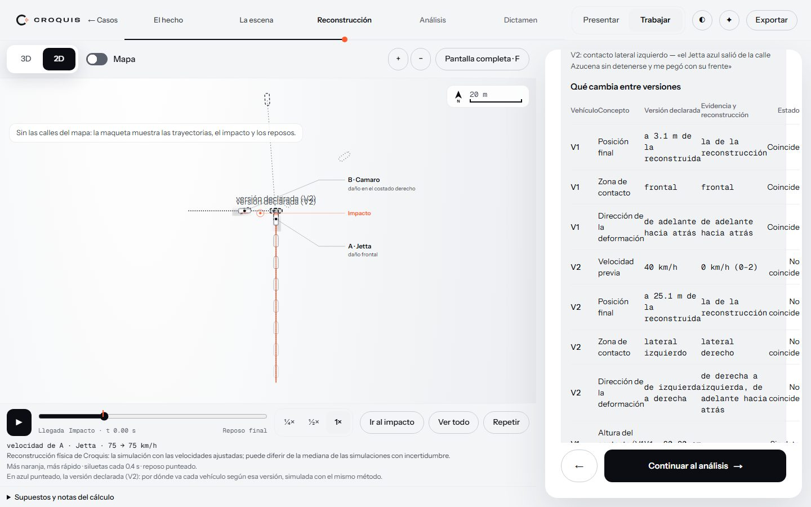
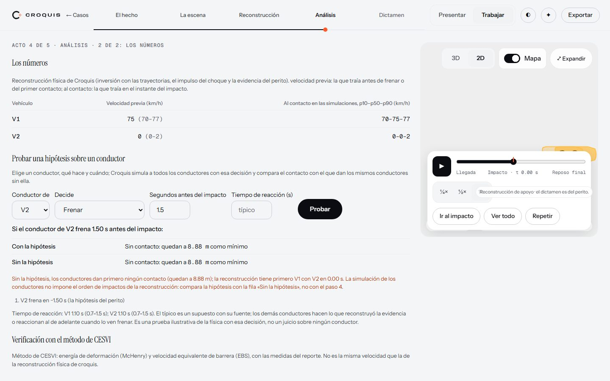
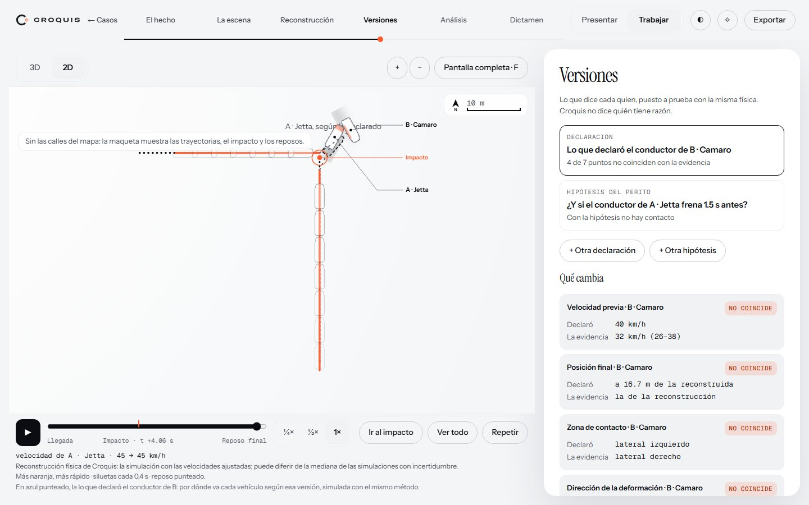
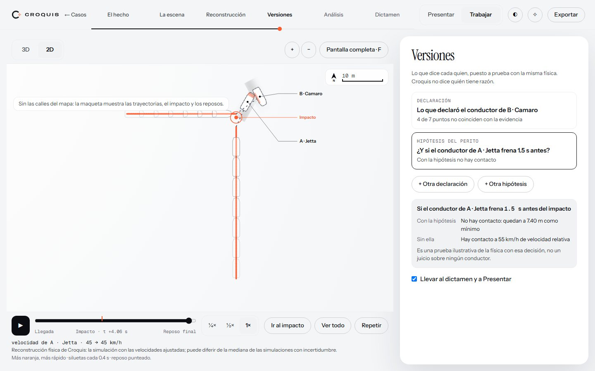
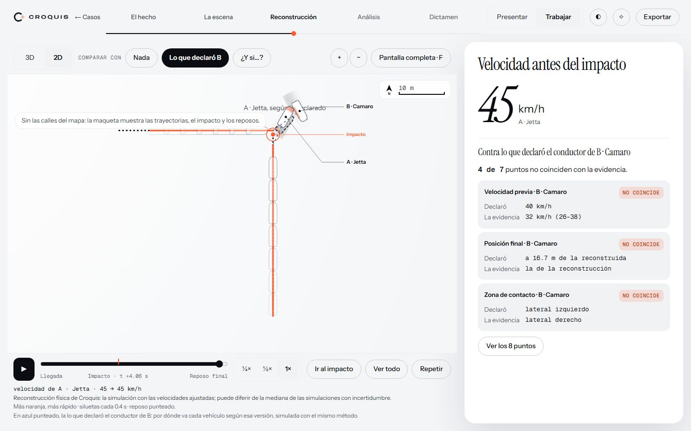
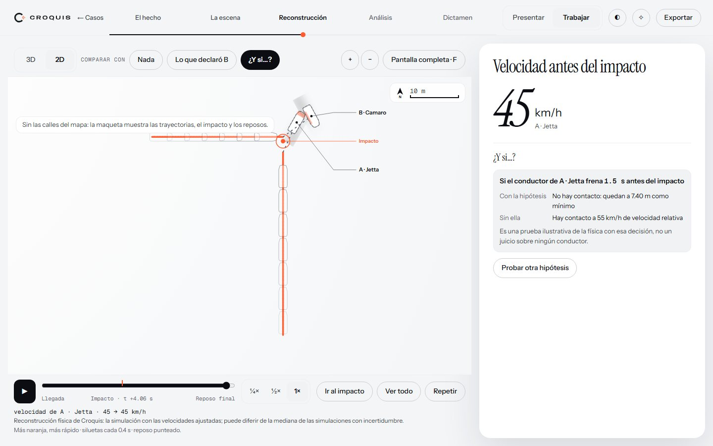
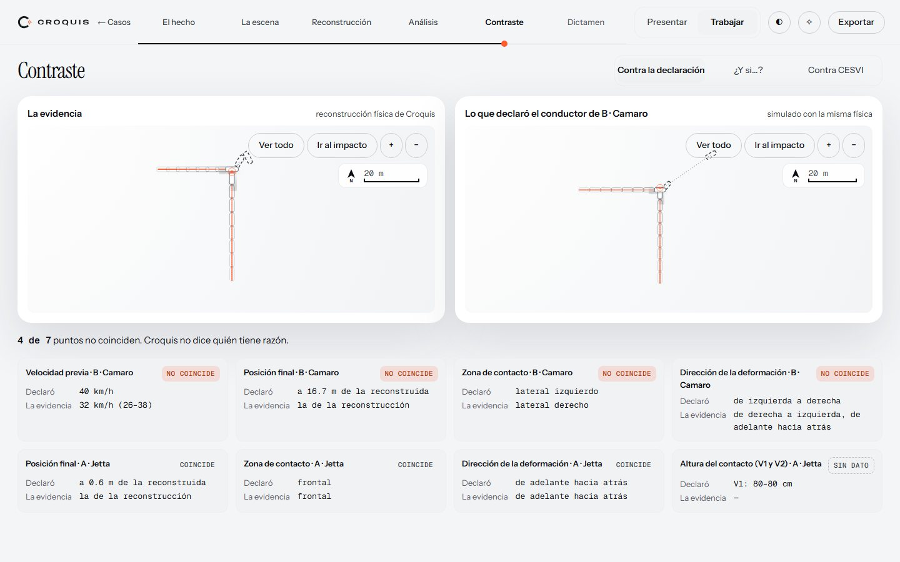

# Ronda 4, punto 8 · Hipótesis y declaración: tres propuestas para elegir

René pidió (2026-11-18) subir al flujo principal «probar hipótesis» y la comparación con la declaración del conductor: es lo que diferencia a Croquis y hoy no se ve. Este documento dice dónde están hoy, qué hace falta en cualquier caso y tres propuestas con capturas. **No se construye nada hasta que René elija.**

Las capturas de las propuestas salen de un prototipo (`/cesvi/propuestas/hipotesis`, rama `feat/ronda4-c-hipotesis`) con los componentes reales y los números calculados sobre el caso de ejemplo (el crucero, con su declaración grabada). Los botones del prototipo no hacen nada todavía.

## 1 · Dónde están hoy

| Qué                                       | Dónde                                                                               | Cómo se ve                        |
| ----------------------------------------- | ----------------------------------------------------------------------------------- | --------------------------------- |
| La declaración del conductor              | «Reconstrucción» → «Ver el detalle» → al fondo, plegada, con la etiqueta «opcional» | Una tabla angosta con «V1» y «V2» |
| «Probar una hipótesis sobre un conductor» | «Análisis» → segunda pantalla («Los números») → al fondo                            | Solo texto                        |

- **Al abrir Reconstrucción, nada dice que se puede comparar:** `evidencia/hipotesis/hoy-1-reconstruccion-como-abre.jpg`.
- **La tabla de la declaración:** `evidencia/hipotesis/hoy-3-que-cambia-la-tabla.jpg`.
- **La hipótesis del conductor:** `evidencia/hipotesis/hoy-6-hipotesis-de-conductor-resultado.jpg`.

**Qué llega hoy a cada vista:**

|                           | 2D                                      | 3D de Unity                                  | Presentar | Dictamen       |
| ------------------------- | --------------------------------------- | -------------------------------------------- | --------- | -------------- |
| Declaración del conductor | Sí, punteada (con la etiqueta encimada) | **No** (solo en el visor ligero de respaldo) | No        | Sí, como tabla |
| Hipótesis «¿y si…?»       | **No**                                  | **No**                                       | No        | No             |

## 2 · Lo que hace falta con cualquier propuesta

1. **Las diferencias en el lenguaje del perito.** Tarjetas por punto (velocidad, zona de contacto, dónde quedó, dirección de la deformación), con «Declaró» y «La evidencia» y un estado claro, y los vehículos por su nombre («B · GM Camaro»), no «V2». Primero lo que no coincide. Sin culpas: Croquis no dice quién tiene razón.
2. **El fantasma en el 2D, bien hecho.** Ya existe; hay que darle su nombre a cada silueta y marcar las diferencias sobre el dibujo (la distancia entre donde quedó y donde habría quedado, la velocidad declarada contra la reconstruida).
3. **El fantasma en el 3D de Unity.** El build publicado reproduce una sola versión. Hay dos caminos:
   - **Sin build nuevo:** alternar. Un botón cambia entre la reconstrucción y la versión del conductor, con la misma cámara y el mismo instante. Sirve desde el primer día.
   - **Con build nuevo:** las dos a la vez, la declarada translúcida. Pide un campo nuevo en `caso-3d` (el segundo resultado), el material translúcido en Unity y un build que compila el colaborador. Estimado: 2 a 3 días, más la corrida en la RTX.
4. **Dibujar el «¿y si…?».** Hoy la simulación de los conductores solo devuelve un resumen: si hay contacto, cuándo y a qué velocidad. No devuelve por dónde va cada vehículo, así que no hay nada que dibujar. Hay que agregar las trayectorias al resultado del solver (Python de referencia, el port TS, paridad y el contrato `resultado`). No cambia ningún número. Estimado: 2 días.
5. **Presentar y el dictamen.** Un capítulo «Versiones» en Presentar y una sección en el dictamen con las diferencias y el croquis con el fantasma. La hipótesis del perito hoy no llega a ninguno de los dos.
6. **La lectura de la declaración** sigue usando Claude (una llamada por declaración, dentro del tope diario). La hipótesis «¿y si…?» no usa IA.

## 3 · Las tres propuestas

En el ejemplo: el conductor de B declaró que iba a 40 km/h; la evidencia da 32 km/h (26–38). De 7 puntos comparables, 4 no coinciden. Y si el conductor de A frena 1.5 s antes, no hay contacto (quedan a 7.40 m); sin eso, hay contacto a 55 km/h de velocidad relativa.

### Propuesta 1 · Un acto propio: «Versiones»

Entre «Reconstrucción» y «Análisis». A la izquierda, el escenario (3D o 2D) con la versión elegida como fantasma; a la derecha, la lista de versiones (cada declaración y cada hipótesis, con su resumen) y, abajo, qué cambia.

- **A favor:**
  - Tiene nombre en la barra: es lo que más se ve, también en la demo.
  - Declaraciones e hipótesis viven juntas, y caben varias (la de A, la de B, dos hipótesis).
  - El escenario conserva su tamaño y el fantasma va superpuesto, como se pidió.
- **En contra:**
  - Un acto más en la barra (seis, o siete con «Contra CESVI»).
  - Hay que decidir qué pasa si el perito no trae declaración: el acto abre con «Agrega una declaración o prueba una hipótesis».
- **Costo:** medio. Un paso nuevo en el recorrido, el panel y las diferencias.

### Propuesta 2 · Dentro de «Reconstrucción», como una capa

Sin acto nuevo. Sobre el visor, «Comparar con: Nada · Lo que declaró B · ¿Y si…?». Al elegir, el fantasma aparece en el escenario y, bajo la cifra, un bloque corto con lo que no coincide.

- **A favor:**
  - Se compara donde el perito ya está mirando: un clic, sin cambiar de pantalla.
  - La cifra de la reconstrucción y la diferencia se leen juntas.
  - Es la más barata.
- **En contra:**
  - No tiene nombre en la barra: en la demo hay que saber que está ahí.
  - «Reconstrucción» ya es la pantalla más cargada; el panel derecho se queda corto para ocho puntos y para escribir la declaración.
- **Costo:** bajo.

### Propuesta 3 · Un acto «Contraste», lado a lado

«Contra CESVI» pasa a llamarse «Contraste» y junta todo lo que se compara: contra la declaración, «¿y si…?» y contra el reporte de CESVI. Las dos versiones van lado a lado, cada una en su croquis, y abajo las diferencias en fila.

- **A favor:**
  - Una sola idea para el perito: «contra qué lo comparo».
  - Las ocho diferencias se ven de un vistazo, sin desplazarse.
  - El acto ya existe cuando el caso trae reporte.
- **En contra:**
  - Lado a lado, cada croquis queda a la mitad y la diferencia hay que buscarla con los ojos; René pidió verlas **superpuestas**.
  - En 3D no caben dos Unity a la vez: ahí habría que alternar o superponer de todos modos.
  - Mezcla dos cosas distintas: lo que concluyó CESVI (referencia) y lo que dice un conductor (versión a prueba).
- **Costo:** medio.

## 4 · Mi recomendación

**La propuesta 1, con la entrada de la 2.** El acto «Versiones» le da nombre y lugar a lo que diferencia a Croquis, y el escenario grande con el fantasma es lo que se pidió. De la propuesta 2 tomaría solo el acceso: en «Reconstrucción», junto a las cámaras, un botón «Comparar con una versión» que lleva al acto. Así se ve desde Reconstrucción sin cargarla más.

«Contra CESVI» se queda como está: compara con el reporte, que es otra cosa.

## 5 · Lo que René decide

1. **Cuál propuesta:** 1, 2, 3, o la 1 con la entrada de la 2.
2. **El nombre del acto:** «Versiones», «Hipótesis» u otro.
3. **El 3D en esta ronda:** alternar (sin build nuevo) o el fantasma en Unity (build nuevo, con el colaborador).
4. **Dibujar el «¿y si…?»:** si entra en esta ronda el cambio del solver que entrega las trayectorias, o primero queda con su resultado en texto.
