# Galería de E5: Croquis junto a las fotos reales

Comparación visual de la deformación (PLAN E5 c, ADR 0032). Cada par muestra la foto posterior a una prueba de choque de NHTSA y la reconstrucción de Croquis de esa prueba, con el mismo cálculo de daño que el visor y desde una vista parecida.

- **Qué recibe Croquis:** la clase, la masa, las dimensiones, la velocidad, el obstáculo y la cara y zona del CDC. No recibe el ancho ni la profundidad medidos.
- **Muestra:** salió del test congelado de NHTSA, con semilla y estratificada por tipo, entre las pruebas con foto de la cara dañada (`uv run croquis-eval e5-galeria` → `eval/results/e5_galeria.json`). Las cifras de E5 están en el README.
- **Color de la carrocería:** es neutro en Croquis.
- **Fotos:** son derivados reducidos y sin metadatos de las originales de la NHTSA Vehicle Crash Test Database (datos públicos del gobierno de EE. UU.; `data/SOURCES.md`). Se cita la fuente de cada una.
- **Renders:** llevan la leyenda ilustrativa (PLAN §10).

| Tipo               | Pruebas del test que Croquis reproduce | Revisadas | Reportes leídos | Fotos rechazadas en la revisión visual | Pares |
| ------------------ | -------------------------------------- | --------- | --------------- | -------------------------------------- | ----- |
| Frontal completo   | 854                                    | 8         | 7               | 4                                      | 3     |
| Frontal desplazado | 84                                     | 84        | 4               | 2                                      | 0     |
| Lateral            | 347                                    | 6         | 4               | 0                                      | 3     |
| Alcance (trasero)  | 47                                     | 47        | 0               | 0                                      | 0     |
| Poste              | 39                                     | 4         | 3               | 0                                      | 3     |

**Tipos sin pares:** en esas pruebas del test no hay una foto posterior de la cara dañada que se pudiera verificar. La mayoría no trae fotos. En las demás, la foto que indica el reporte resultó ser otra vista.

**Revisión visual:** el número que da el reporte no siempre es el del archivo, así que cada foto elegida se revisó a ojo. Las que no muestran la cara dañada después de la prueba quedan rechazadas, con su motivo, en `eval/e5/galeria_revision.json`, y la selección pasa al siguiente caso.

**Lo que se ve:**

- **Frontales:** la deformación de Croquis es mucho menor que la real. Eso coincide con la profundidad máxima de E5 en NHTSA y con el límite de energía del ADR 0033.
- **Laterales y postes:** el lugar y la forma del hundimiento se reconocen, sin el detalle de las piezas rotas.

## Prueba 14990: Frontal completo, frente

| Foto real (NHTSA)                                     | Croquis                                                     |
| ----------------------------------------------------- | ----------------------------------------------------------- |
| 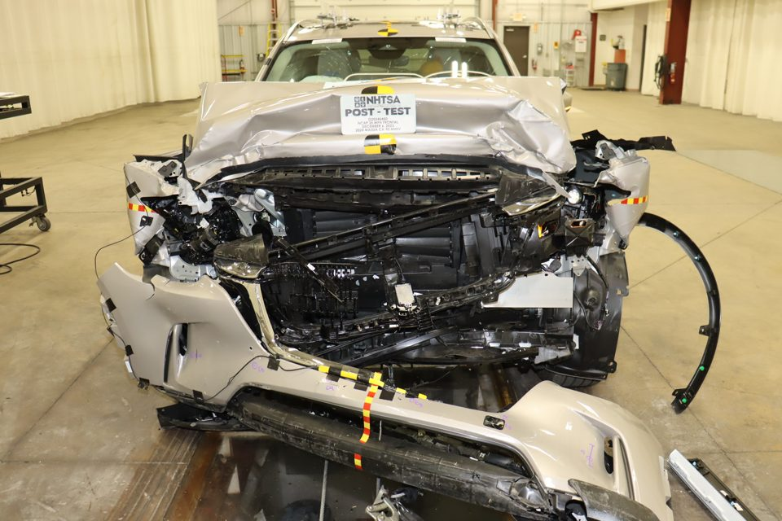 | 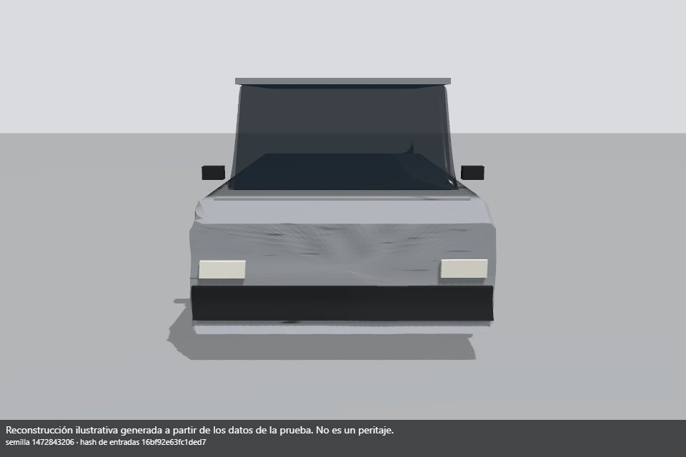 |

- **Vista de la foto:** Post-Test Front View of Test Vehicle.
- **Clase en Croquis:** `suv_grande`. **Obstáculo:** VTB: LOAD CELL BARRIER.
- **Fuente:** NHTSA Vehicle Crash Test Database, prueba 14990, [foto original](https://nrd-static.nhtsa.dot.gov/photos/vehdb/v10000/v14900/v14990P009.JPG) (`v14990P009.JPG`; hallada por la lista de fotografías del reporte).

## Prueba 8314: Frontal completo, frente

| Foto real (NHTSA)                                   | Croquis                                                   |
| --------------------------------------------------- | --------------------------------------------------------- |
| 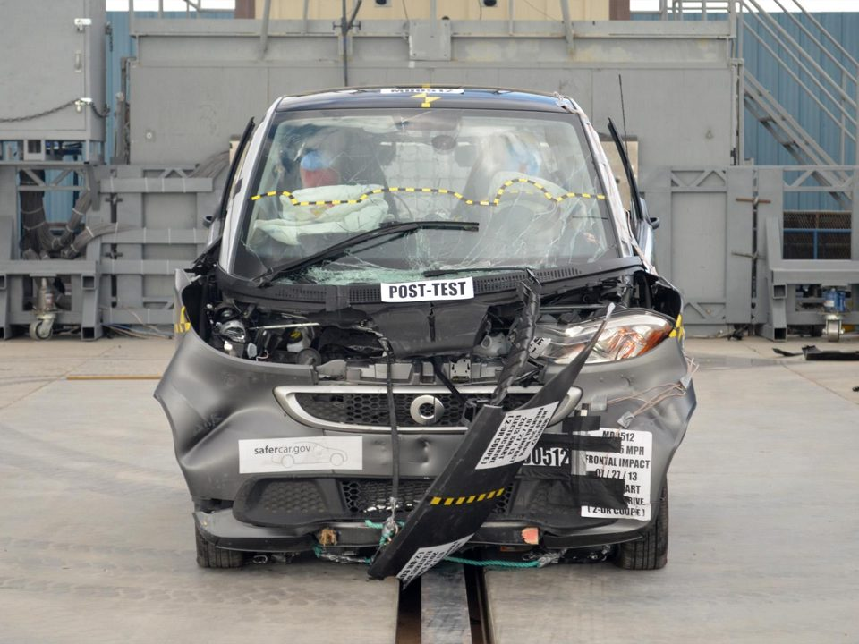 | 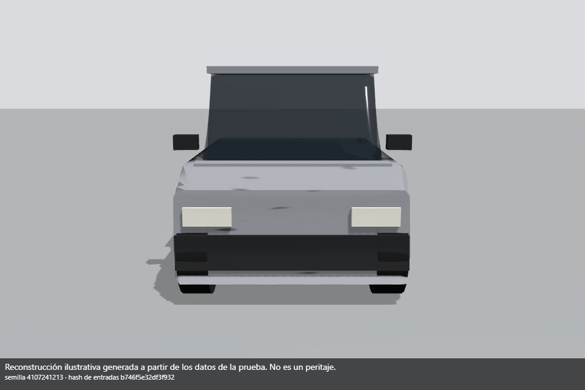 |

- **Vista de la foto:** Post-Test Front View of Test Vehicle.
- **Clase en Croquis:** `sedan_compacto`. **Obstáculo:** VTB: LOAD CELL BARRIER.
- **Fuente:** NHTSA Vehicle Crash Test Database, prueba 8314, [foto original](https://nrd-static.nhtsa.dot.gov/photos/vehdb/v00000/v08300/v08314P008.jpg) (`v08314P008.jpg`; hallada por la lista de fotografías del reporte).

## Prueba 11295: Frontal completo, frente

| Foto real (NHTSA)                                     | Croquis                                                     |
| ----------------------------------------------------- | ----------------------------------------------------------- |
| 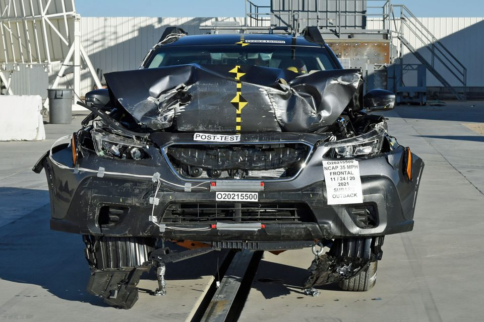 | 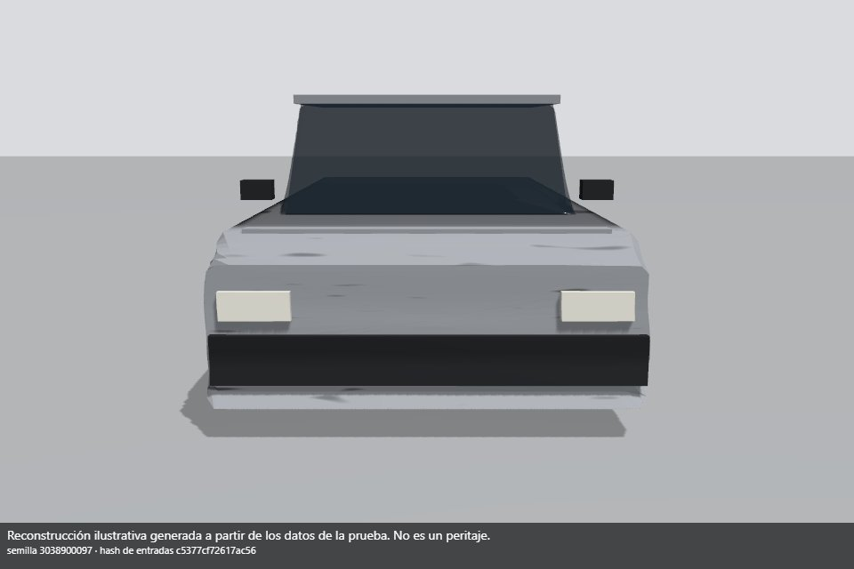 |

- **Vista de la foto:** Post-Test Front View of Test Vehicle.
- **Clase en Croquis:** `sedan_mediano`. **Obstáculo:** VTB: LOAD CELL BARRIER.
- **Fuente:** NHTSA Vehicle Crash Test Database, prueba 11295, [foto original](https://nrd-static.nhtsa.dot.gov/photos/vehdb/v10000/v11200/v11295P009.jpg) (`v11295P009.jpg`; hallada por la lista de fotografías del reporte).

## Prueba 9064: Lateral, costado izquierdo

| Foto real (NHTSA)                                   | Croquis                                                   |
| --------------------------------------------------- | --------------------------------------------------------- |
| 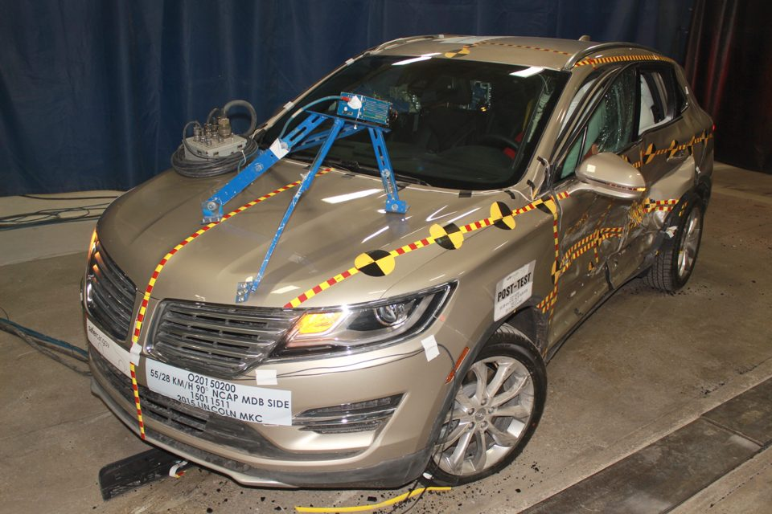 | 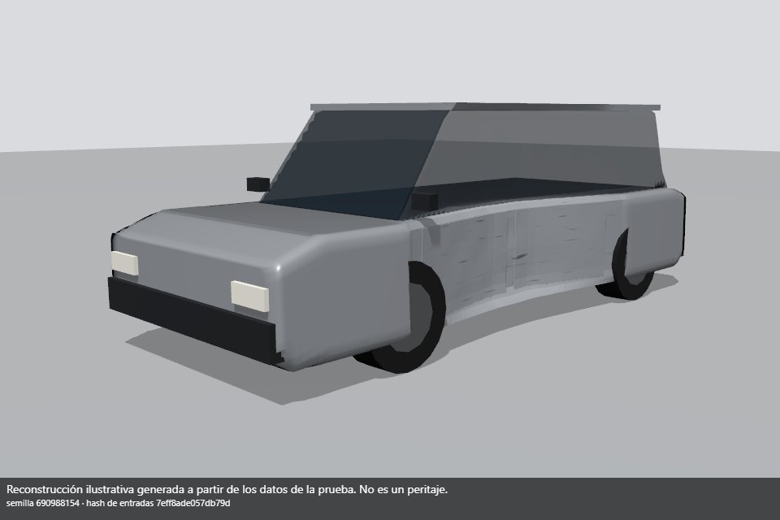 |

- **Vista de la foto:** Post-Test Left Front Three-Quarter View of Test Vehicle.
- **Clase en Croquis:** `suv_compacta`. **Obstáculo:** ITV: OPTIONAL NEW CAR ASSESSMENT TEST.
- **Fuente:** NHTSA Vehicle Crash Test Database, prueba 9064, [foto original](https://nrd-static.nhtsa.dot.gov/photos/vehdb/v00000/v09000/v09064P006.jpg) (`v09064P006.jpg`; hallada por la lista de fotografías del reporte).

## Prueba 10157: Lateral, costado izquierdo

| Foto real (NHTSA)                                     | Croquis                                                     |
| ----------------------------------------------------- | ----------------------------------------------------------- |
| 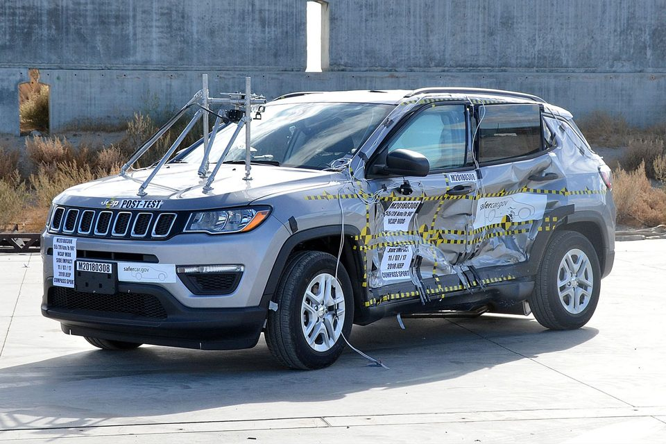 | 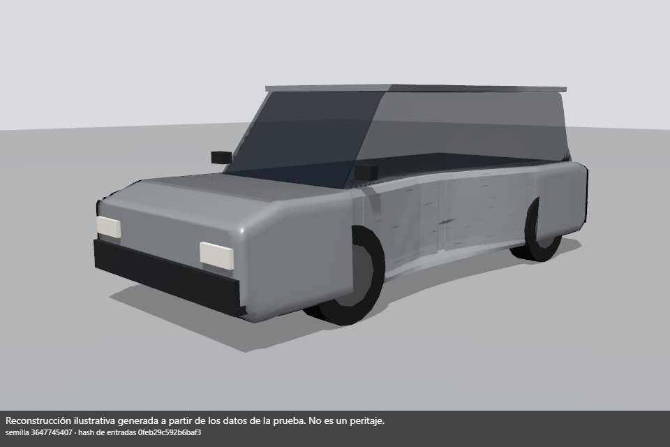 |

- **Vista de la foto:** Post-Test Left Front ¾ View of Test Vehicle.
- **Clase en Croquis:** `suv_compacta`. **Obstáculo:** ITV: NEW CAR ASSESSMENT TEST.
- **Fuente:** NHTSA Vehicle Crash Test Database, prueba 10157, [foto original](https://nrd-static.nhtsa.dot.gov/photos/vehdb/v10000/v10100/v10157P006.jpg) (`v10157P006.jpg`; hallada por la lista de fotografías del reporte).

## Prueba 7071: Lateral, costado izquierdo

| Foto real (NHTSA)                                   | Croquis                                                   |
| --------------------------------------------------- | --------------------------------------------------------- |
| 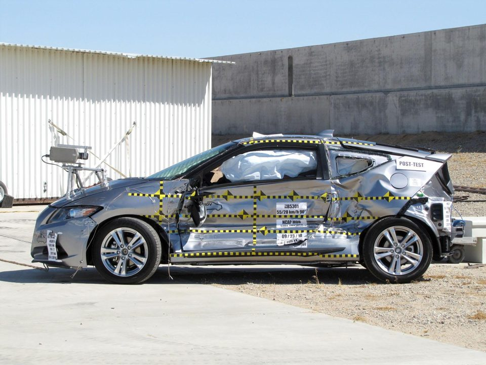 | 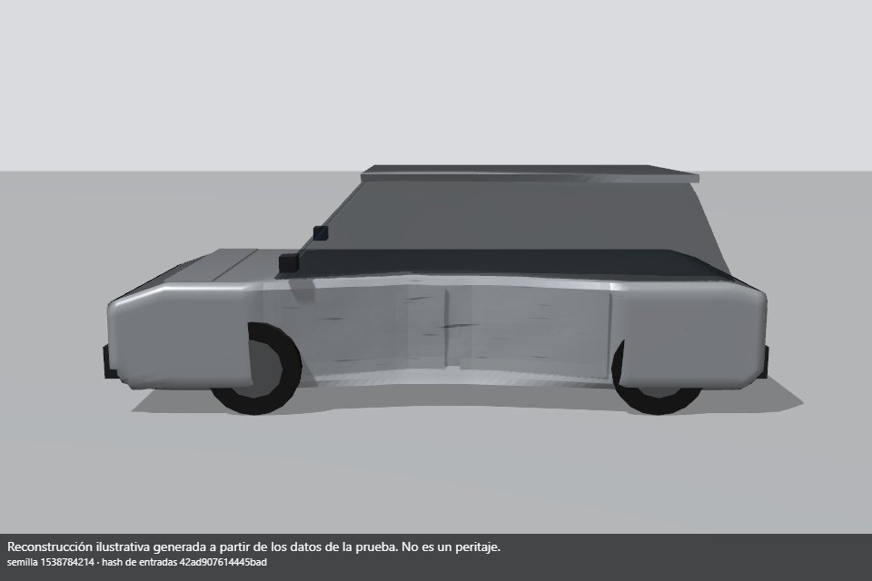 |

- **Vista de la foto:** Post-Test Left Side View of Test Vehicle.
- **Clase en Croquis:** `hatchback`. **Obstáculo:** ITV: OPTIONAL NEW CAR ASSESSMENT TEST.
- **Fuente:** NHTSA Vehicle Crash Test Database, prueba 7071, [foto original](https://nrd-static.nhtsa.dot.gov/photos/vehdb/v00000/v07000/v07071P008.jpg) (`v07071P008.jpg`; hallada por la lista de fotografías del reporte).

## Prueba 5436: Poste, costado izquierdo

| Foto real (NHTSA)                                   | Croquis                                                   |
| --------------------------------------------------- | --------------------------------------------------------- |
| 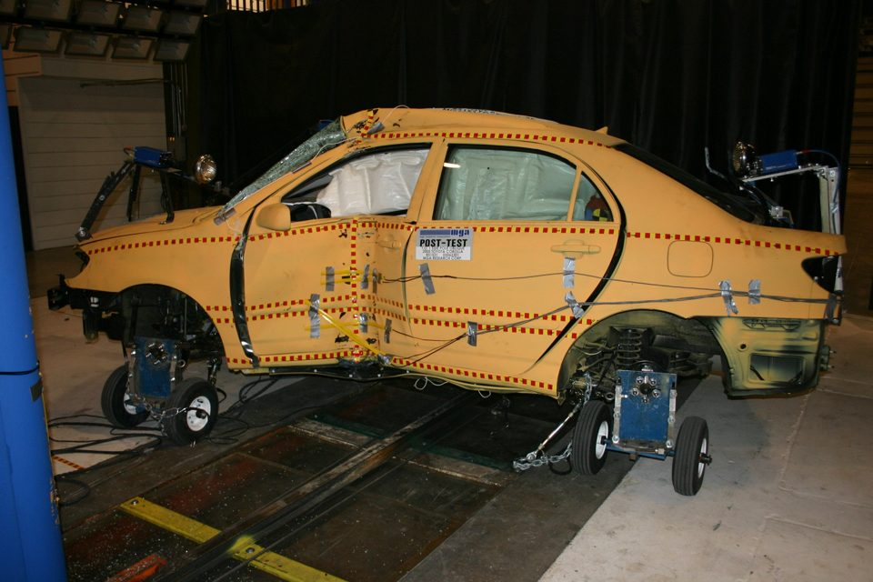 | 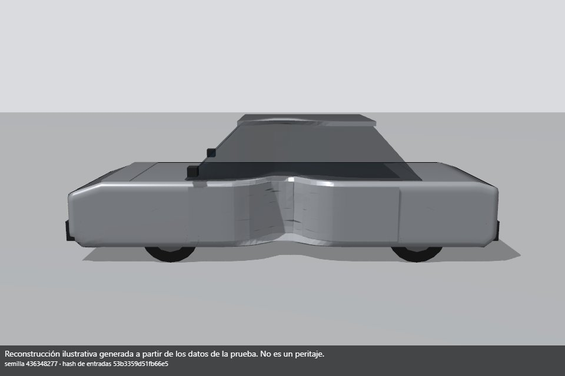 |

- **Vista de la foto:** Post-Test Left Side View of Test Vehicle.
- **Clase en Croquis:** `sedan_compacto`. **Obstáculo:** VTB: POLE.
- **Fuente:** NHTSA Vehicle Crash Test Database, prueba 5436, [foto original](https://nrd-static.nhtsa.dot.gov/photos/vehdb/v00000/v05400/v05436P006.jpg) (`v05436P006.jpg`; hallada por la lista de fotografías del reporte).

## Prueba 4389: Poste, costado izquierdo

| Foto real (NHTSA)                                   | Croquis                                                   |
| --------------------------------------------------- | --------------------------------------------------------- |
| 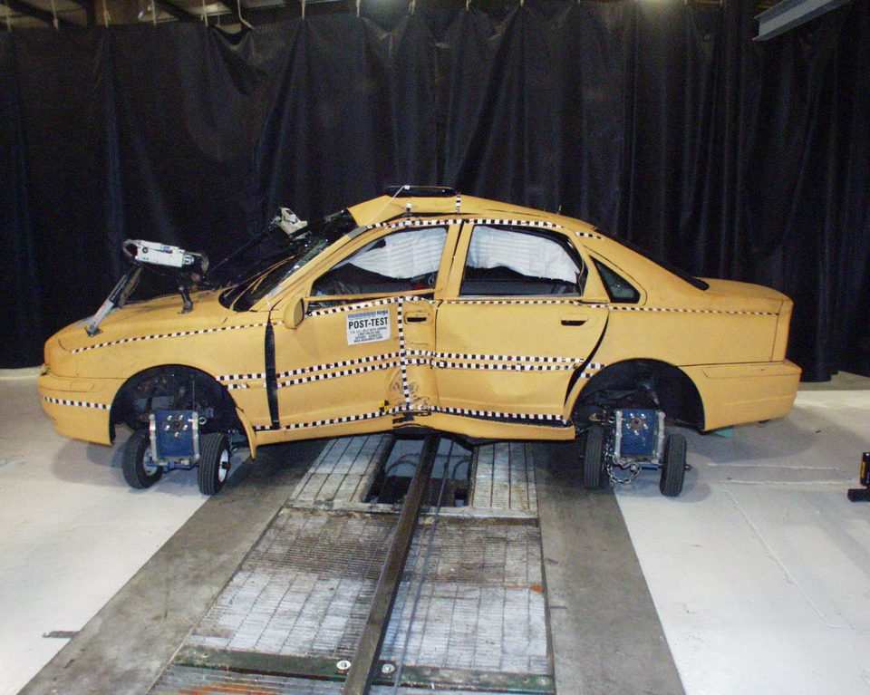 | 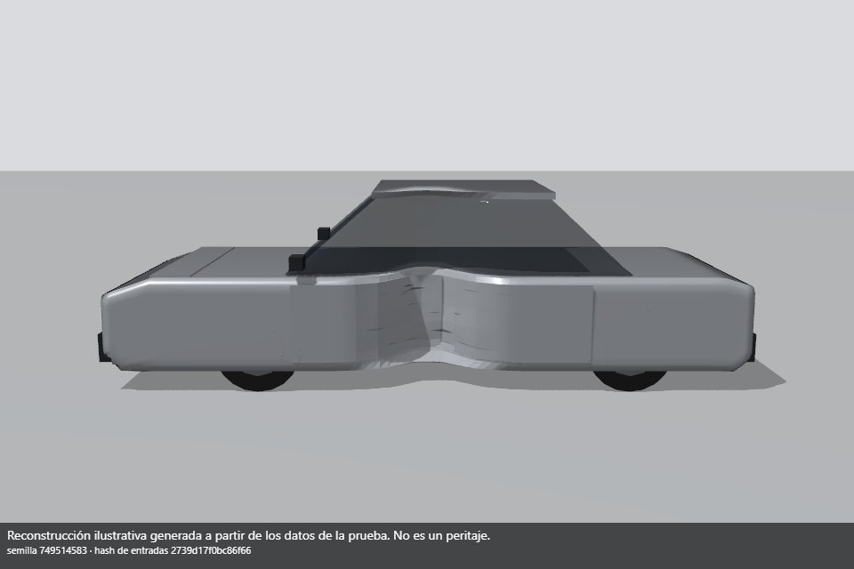 |

- **Vista de la foto:** Post-Test Left Side View of Test Vehicle.
- **Clase en Croquis:** `sedan_mediano`. **Obstáculo:** VTB: POLE.
- **Fuente:** NHTSA Vehicle Crash Test Database, prueba 4389, [foto original](https://nrd-static.nhtsa.dot.gov/photos/vehdb/v00000/v04300/v04389P006.jpg) (`v04389P006.jpg`; hallada por la lista de fotografías del reporte).

## Prueba 4285: Poste, costado izquierdo

| Foto real (NHTSA)                                   | Croquis                                                   |
| --------------------------------------------------- | --------------------------------------------------------- |
| 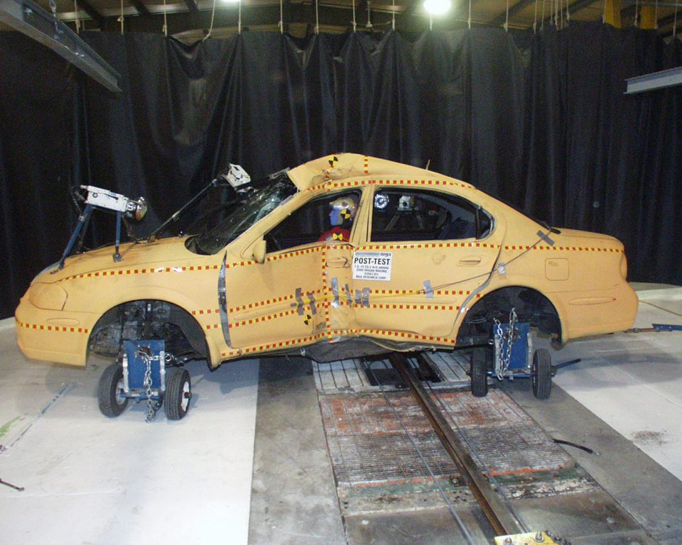 | 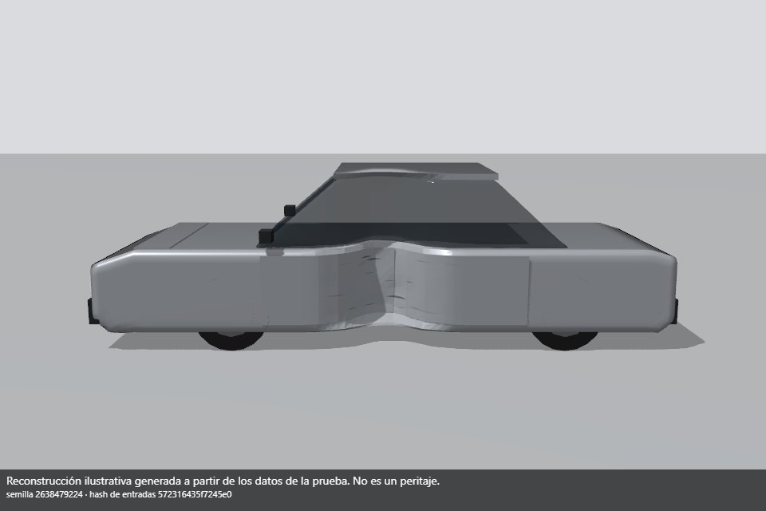 |

- **Vista de la foto:** Post-Test Left Side View of Test Vehicle.
- **Clase en Croquis:** `sedan_mediano`. **Obstáculo:** VTB: POLE.
- **Fuente:** NHTSA Vehicle Crash Test Database, prueba 4285, [foto original](https://nrd-static.nhtsa.dot.gov/photos/vehdb/v00000/v04200/v04285P006.jpg) (`v04285P006.jpg`; hallada por la lista de fotografías del reporte).
